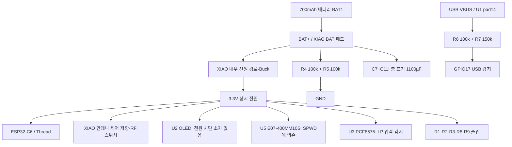

# 실제 v6 회로도·PCB 절전 분석

작성일: 2026-10-21. 대상은 사용자가 지정한 `somfy_blinds_v6.kicad_sch`와 `somfy_blinds_v6.kicad_pcb`다. 배터리는 700mAh, OLED는 하루 20~50회·회당 10초, 현재 SmartThings 지연 유지를 전제로 한다.

**판정: 배터리 분압이 주원인은 아니다. 가장 큰 새 발견은 XIAO 내부의 안테나 제어 저항 소비다.** 제조사 v1.0 회로와 같은 모듈이면 현재 외장 안테나 설정에서 두 저항에 약 **0.977mA@3.3V**가 계속 흐르는 경로가 있다. 그 외 OLED 모듈의 OFF 소비와 PCF8575 입력 상태를 확인해야 한다. 현재 자료만으로 15일 불가능 또는 달성을 확정할 수는 없다.

도면·PCB·펌웨어를 수정하지 않았다. 새 분석 문서·추출 자료만 만들었고 기기 연결·플래시·전류 측정은 하지 않았다. 현재 작업 폴더에는 사용자의 미커밋 펌웨어 개선이 있으며 그대로 보존했다. 이전 보고서의 진동 결함을 현재도 미수정이라고 전제하지 않았다.

## 1. 무엇을 확인했는가

| 검토 대상 | 확인 결과 |
|---|---|
| 지정 회로도 | KiCad 10.0.6으로 netlist·SVG 추출. 일반 부품 36개, 저항 9개, 커패시터 11개 |
| 지정 PCB | 풋프린트 41개. 전원·신호 pad net을 회로도와 대조 |
| PCB DRC | 저장된 copper 및 메모리상 zone 재계산 모두 **배선 미연결 0, 일반 오류 0, 경고 52** |
| 회로도/PCB parity | BAT1의 고정 패드 MP 2개가 회로도에 없음. 일반 신호 배선 불일치로 보고된 것은 아님 |
| 회로도 ERC | 오류 2, 경고 96. 아래에서 의미를 별도 설명. ERC 완전 통과 상태는 아님 |
| XIAO 내부 | Seeed v1.0 제조사 회로도 전원·RF 페이지를 시각 확인 |
| 펌웨어 연결 | 보드 핀 정의, 안테나 GPIO 설정, 실제 저장 빌드의 외장 안테나 정의, LP I2C 설정 확인 |
| 부품 정보 한계 | 사용자는 OLED와 C7~C11의 실제 부품번호를 모름. 도면 표시값과 제조사 일반 자료로만 평가 |

원본 해시·부품별 net은 [hardware_nets.json](D:/dev/workspaces/somfy-blinds-things-by-claude/doc/assets/hardware_power_audit_2026-10-21/hardware_nets.json)에 있다. [DRC](D:/dev/workspaces/somfy-blinds-things-by-claude/doc/assets/hardware_power_audit_2026-10-21/pcb_drc_refill.json), [ERC](D:/dev/workspaces/somfy-blinds-things-by-claude/doc/assets/hardware_power_audit_2026-10-21/schematic_erc.json)도 보존했다. 정적 검사에서 단락·미연결이 검출되지 않은 사실은 누설 전류·실장 품질·실기 소비까지 보증하지 않는다.

## 2. 실제 전원 구조

- 외부 OLED·무선·PCF 전원은 모두 `+3V3`에 직결된다. 화면 OFF나 RF sleep은 전원선을 끊는 동작과 다르다.
- BAT1−와 C7~C11−는 `BAT-`, 나머지 회로는 `GND`다. 둘은 XIAO 내부의 공통 GND를 통해 연결된다. 이름이 다르다는 이유만으로 단선이라고 판단하지 않았다.
- 이 보드의 `+5V`는 **U1 pad14의 VBUS**다. 제조사 회로의 배터리/USB 합류 뒤 내부 `+5V`와 구별해야 한다. 따라서 R6/R7을 배터리에 직접 물린 상시 분압으로 계산하지 않았다. [Seeed 공식 회로도, 전원 페이지](https://files.seeedstudio.com/wiki/SeeedStudio-XIAO-ESP32C6/XIAO_ESP32_C6_v1.0_SCH_260114.pdf).

## 3. 최우선 발견 — XIAO 모듈 내부 안테나 제어 저항

**여기서 R21/R24는 사용자 PCB의 부품이 아니라 XIAO 모듈 내부 부품이다.** 사용자 회로도에서는 U1 한 개로 생략돼 있으므로 외부 저항 9개만 합산하면 빠진다.

| 제조사 내부 경로 | 현재 제어 | 저항 소비 계산 | 3.3V 전류 |
|---|---|---:|---:|
| 3.3V → R21 10k → GPIO3 | RF 스위치 전원 활성: LOW | 3.3/10,000 | **0.330mA** |
| GPIO14 → R24 5.1k → GND | 외장 안테나 선택: HIGH | 3.3/5,100 | **0.647mA** |
| 외장 모드 합계 | LOW/HIGH 유지 | 위 두 경로 합계 | **0.977mA** |
| 내장 모드, 현재 EN 정책 유지 | GPIO3 LOW, GPIO14 LOW | R21 경로 유지 | **0.330mA** |

근거: [Seeed 공식 v1.0 회로도, RF 페이지](https://files.seeedstudio.com/wiki/SeeedStudio-XIAO-ESP32C6/XIAO_ESP32_C6_v1.0_SCH_260114.pdf). R22/R23은 대체 바이어스용 미실장 위치로 표시돼 있다. 실제 모듈 리비전·실장값은 확인하지 않았으므로 **회로에 근거한 계산이며 실측 전류는 아니다.**

현재 [app_main.cpp:943](D:/dev/workspaces/somfy-blinds-things-by-claude/main/app_main.cpp:943)은 GPIO3을 LOW로, [945행](D:/dev/workspaces/somfy-blinds-things-by-claude/main/app_main.cpp:945)은 안테나 모드에 맞춰 GPIO14를 설정한다. 이어 두 핀의 sleep 전환을 제외한다. `build-xiao-c6/CMakeCache.txt`와 해당 소스의 compile command에는 **`BOARD_OVR_RF_EXT_ANT=1`**이 있다. 저장된 빌드는 외장 모드다. 이 자료만으로 현재 실기에 올라간 바이너리까지 동일하다고 증명하지는 않는다.

### 얼마나 큰가

배터리 3.7V, 변환 효율 90%를 가정하면:

`배터리 전류 = 3.3V 레일 전류 × 3.3 / (3.7 × 0.90)`

- 약 **0.968mA**, 하루 **23.24mAh**, 15일 **348.6mAh**.
- 가용 용량 560mAh 가정의 **62.2%**를 이 두 저항만으로 쓰는 규모다. RF 스위치 자체·CPU·무선·OLED는 아직 더하지 않았다.
- 이 손실은 CPU가 더 오래 자거나 버튼 백업 주기를 늘려도, 해당 핀 레벨이 유지되는 동안 남는다.

### 수정 후보 — 분석만 제시

| 후보 | 기대 효과 | 조건 |
|---|---|---|
| 실제 통신이 충분하면 내장 안테나 선택 | R24 소비 약 **0.647mA@3.3V** 감소 | 수신 감도·명령 지연·재전송이 악화되면 이득 감소 |
| 외장 모드 고정에 맞춰 내부 바이어스 재구성 | 두 저항의 반대 방향 DC 경로 약 **0.977mA@3.3V** 해소 가능 | 제조사 R21/R22·R24/R23 옵션과 실제 모듈 리비전 확인 필요 |
| 바이어스 저항을 더 크게 하는 설계 | 예: 두 경로 모두 100k이면 약 **0.911mA@3.3V** 감소 | 예시값이며 부팅 기본 상태·GPIO 입력 시 레벨·누설·RF 안정성 검증 전 |

외장 모드 고정이라면 현재 구동 레벨과 같은 방향으로 기본 바이어스를 구성하는 방법을 검토할 수 있다. 다만 이는 **XIAO 모듈 개조/다음 설계 후보**이며 외부 PCB의 R1~R9를 바꾸는 작업과 다르다. GPIO3을 무조건 HIGH로 바꿔 RF 스위치 전원을 끄는 방식은 Thread 수신을 유지하는 검증 없이 적용하면 안 된다.

## 4. 외부 PCB의 소비 경로

### 4.1 R4/R5 배터리 분압 — 정상이며 규모가 작다

BAT+ → R4 100k → BAT_ADC → R5 100k → GND다. C6 0.1µF가 ADC 노드를 안정화한다.

| 배터리 전압 | 분압 전류 | 하루 소모 |
|---:|---:|---:|
| 4.2V | 21.0µA | 0.504mAh |
| 3.7V | **18.5µA** | **0.444mAh** |
| 3.3V | 16.5µA | 0.396mAh |

3.7V 기준 15일 6.66mAh, 가용 560mAh의 1.19%다. 이 경로 하나를 제거해서 여러 날을 확보한다고 볼 수 없다. 1M/1M으로 바꾸는 예에서도 절감은 약 0.400mAh/일이다. 저항 증대 시 ADC 입력 누설·오차·정착 시간을 함께 검증해야 한다.

기존 100k/100k의 출력 저항은 50k, C6와의 시정수는 약 5ms다. 1M/1M이면 약 50ms가 된다. 고임피던스로 무조건 바꾸는 것은 우선순위가 낮다.

### 4.2 R6/R7 USB 감지 — 배터리 상시 20µA로 합산하지 않는다

VBUS 5V → R6 100k → CHG_STAT → R7 150k → GND. USB 연결 시 약 3.0V, 분압 전류 20µA다. 배터리 단독에서는 VBUS 역누설 등을 제외하면 USB 전원이 없으므로 같은 20µA가 흐른다고 계산하지 않는다.

GPIO17의 내부 풀업·풀다운을 끄는 현재 보드 설정과도 맞는다. 내부 약 45k 풀다운을 다시 켜면 분압 전압을 끌어내려 USB 오판과 불필요한 상태 전환을 일으킬 수 있다. 실제 회로의 100k/150k 비율은 현재 코드 전제와 일치한다.

### 4.3 I2C 풀업 — HIGH일 때와 LOW 고정을 구분해야 한다

| 부품 | 연결 | LOW일 때 저항 전류 |
|---|---|---:|
| R1 4.7k | LP_I2C_SCL → 3.3V | 0.702mA |
| R2 4.7k | LP_I2C_SDA → 3.3V | 0.702mA |
| R8 4.7k | OLED I2C_SCL → 3.3V | 0.702mA |
| R9 4.7k | OLED I2C_SDA → 3.3V | 0.702mA |
| R3 10k | PCF_INT → 3.3V | 0.330mA + GPIO 내부 풀업분 |

정상 유휴 HIGH이면 4.7k마다 0.702mA가 계속 흐르는 것은 아니다. 반대로 **한 버스의 두 선이 LOW로 고정되면 외부 풀업만 약 1.404mA**다. GPIO·버스 실패의 영향이 정상 분압보다 훨씬 크다.

SW_I2C1은 PCF를 OLED 공용 버스 또는 LP 전용 버스에 선택 연결한다. 정상 선택 상태에서 R1/R2와 R8/R9를 모두 같은 버스에 병렬 연결된 것으로 계산하면 안 된다. OLED 모듈에 별도 풀업이 있다면 R8/R9와의 병렬 여부는 실물 확인이 필요하다.

LP I2C는 현재 SDK 기본 설정상 **400kHz**, LP 폴 간격은 약 5ms다. 예를 들어 초당 200회·읽기 27클럭·SCL LOW 50%로 두면 R1의 평균 소비는 약 **4.74µA**다. SDA·INT·내부 풀업·PCF·LP 코어 소비는 별도다. 따라서 정상 짧은 전송과 LOW 고정의 0.702mA를 혼동하면 안 된다.

절감을 위해 풀업을 무조건 키우는 것도 적절하지 않다. PCB의 긴 배선과 400kHz에서 상승 시간 여유가 줄면 읽기 오류·재시도·HP 폴백으로 소비가 더 커질 수 있다. [TI PCF8575 타이밍 표](https://www.ti.com/lit/ds/symlink/pcf8575.pdf).

### 4.4 진동 스위치 VS1 — 센서 자체는 무전원, GPIO 풀업은 소비한다

VS1 C06은 VIBRATION과 GND 사이의 접점이며 별도 전원 회로가 없다. 다만 현재 [button_handler.c](D:/dev/workspaces/somfy-blinds-things-by-claude/main/button_handler.c:1397)는 이 GPIO의 내부 풀업을 켠다.

접점이 닫혀 LOW이면 풀업을 통해 전류가 흐른다. 내부 저항을 **45k로 가정한 예**는 약 73µA@3.3V이며, 실제 저항·개체차는 미측정이다. HIGH이면 이 접점 경로의 DC 소비는 작아지지만, 잘못된 wake/IRQ 정책으로 생기는 CPU 기상 비용은 별도다. 접점 전류와 기상 전류를 분리해야 한다.

현재 작업본에는 LOW 복귀를 기다려 재활성하는 10/20 개선이 들어 있다. 이전 10/19의 30ms 재발화 지적을 현재 코드에도 그대로 적용하지 않았다. 이번 도면에서 대기 중 센서 전원을 켜야 하는 능동 센서 회로는 확인되지 않았다.

## 5. 주변장치와 모듈의 판단

### OLED U2 — OFF 대기 전류를 먼저 확인할 부품

U2는 3.3V 직결 4핀 모듈이며 전원 차단 FET·load switch가 없다. 코드의 화면 OFF는 컨트롤러 명령이고, 모듈 전체가 0µA가 되는 증거가 아니다. 모듈 내 레귤레이터·풀업·컨트롤러 구성과 OFF 대기 소비는 부품번호가 없어 확정할 수 없다. 도면은 0.96인치로 표기하며, 사용자의 0.94인치 표현만으로 실제 컨트롤러를 특정하지 않았다.

**확보량은 측정 후 결정:** OFF 소비가 0.1mA라면 전원 차단으로 줄일 수 있는 몫은 약 2.38mAh/일, 1mA라면 약 23.78mAh/일이다. 배터리 3.7V·효율 90%에서의 예시이며 실제 모듈 값이 아니다.

전원 차단을 추가할 경우 SDA/SCL의 3.3V 풀업이 꺼진 모듈로 역급전하지 않게 해야 한다. VCC만 끊으면 설계 의도대로 절감되지 않을 수 있다. PCF를 LP 버스에 두면 OLED 전원 정책을 분리하기는 쉬워진다.

### PCF8575 U3 — 본체 대기 전류보다 접점 전류와 샘플링을 구분

TI PCF8575의 무부하 standby는 전형 2.5µA·최대 10µA이고, 포트 HIGH를 외부에서 LOW로 끌 때 전류원은 표상 **30~300µA/핀**이다. 이 포트 전류는 무부하 standby 수치에 포함해 계산하면 안 된다. [TI 전기 특성 표 5.5](https://www.ti.com/lit/ds/symlink/pcf8575.pdf).

ENC1의 A/B 접점은 P0/P1, 공통은 GND다. 정지 위치에서 닫혀 있는 상마다 전류가 남을 수 있다. 두 상이 닫힌 경우 표 범위로는 60~600µA지만, **최대치를 이 장치의 일반 소비로 단정하지 않는다.** 버튼을 누르는 중에도 같은 종류의 전류가 흐른다. 사용하지 않는 P13~P17을 외부에서 억지로 LOW에 연결하면 이 경로를 추가할 수 있으므로, 현재 NC인 상태를 단순히 GND로 바꾸는 제안은 적절하지 않다.

PCF 전원을 끄면 버튼·로터리 감시가 사라진다. 버튼 반응을 유지하려는 조건에서는 OLED와 같은 방식으로 전원 차단 대상으로 묶지 않는다.

### CC1101 모듈 U5 — 상시 전원 자체보다 SPWD 유지 여부가 중요

E07-400MM10S의 전원·SPI pin은 도면과 PCB에서 일치한다. 별도 상시 LED나 외부 레귤레이터는 이 보드에 추가돼 있지 않다. 정상 SPWD의 CC1101 칩 전형값은 약 0.2µA, IDLE은 약 1.7mA다. 모듈 전체의 실제 값과 동일하다고 단정하지 않는다. [TI CC1101 데이터시트](https://www.ti.com/lit/ds/symlink/cc1101.pdf).

SPI_CS의 외부 풀업은 없지만 [cc1101.c:248](D:/dev/workspaces/somfy-blinds-things-by-claude/main/cc1101.c:248)에 sleep 중 내부 풀업이 있다. 이를 제거하면 절감보다 재기상 위험이 커질 수 있다. 정상 SPWD가 유지된다면 CC 전원 차단 추가의 이득은 작을 수 있다. 먼저 실제 CS 레벨·모듈 전류로 판별한다.

### C7~C11 — 총 1100µF는 수명 보장 수단이 아니다

표시값은 220µF/6.3V/1206 5개, BAT+와 BAT− 사이 병렬이다. 충방전 자체가 매 순간 큰 DC 소비를 만드는 부품은 아니지만, 누설은 실제 품번에 따라 달라진다. 실제 실장 용량·품번을 모르므로 누설을 0이나 수 mA로 확정하지 않는다.

1100µF를 0→4.2V 한 번 충전하는 전하는 약 **0.00128mAh**다. 단발 충전량은 700mAh에 비해 매우 작다. 반대로 누설이 개당 10µA라고 가정하면 5개 합계 50µA, 하루 1.2mAh다. 이는 예시일 뿐 실측이 아니다. 커패시터를 먼저 제거하기보다 누설과 전압 안정화 역할을 함께 확인한다.

## 6. 회로도와 펌웨어 연결에서 발견한 별도 불일치

| 항목 | 도면/PCB | 현재 코드 | 의미 |
|---|---|---|---|
| 독립 STOP 버튼 | U3 P2, pin6 | `PCF8574_BIT_ROT_BTN=2` | STOP 입력에 매핑됨 |
| ENC1 S 접점 | ROT_SW → U3 **P12, pin15** | bit10 입력의 별도 이벤트 처리가 보이지 않음 | PCF 명칭 P12는 데이터 **bit10**이다. 휠 스위치와 독립 STOP은 다른 입력 |
| 센서 | VS1 → GPIO0 | GPIO0 | 일치 |
| 배터리 ADC | R4/R5 → GPIO1 | GPIO1 | 일치 |
| USB 감지 | R6/R7 → GPIO17 | GPIO17, 내부 풀다운 OFF | 일치 |
| PCF LP I2C | GPIO6 SDA / GPIO7 SCL | 동일 | 스위치가 LP 위치라는 조건 |

ENC1 S를 의도적으로 사용하지 않는다면 기능 선택이다. 사용해야 한다면 하드웨어 net과 입력 매핑을 맞춰야 한다. 폴링 주기나 절전 시간을 줄여도 이 매핑 문제는 해결되지 않는다. 회로도는 SIQ-02FVS3인데 일부 코드 주석은 EC05로 남아 있으므로 주석을 실제 부품의 검증 자료로 취급하지 않았다.

## 7. 검사 오류의 해석

- ERC의 SCL “구동 핀 없음”은 선택 스위치를 통해 연결되는 net과 심볼의 `Unspecified` pin 모델을 반영한다. 실제 선택 위치에서 구동 가능한지 확인해야 하며, 이 메시지 하나로 실물 SCL 단선이라고 단정하지 않는다.
- ERC의 `#PWR015`는 `+3V3` 구동 선언 문제다. U1의 전원 출력 pin 모델·PWR_FLAG를 정리할 항목이며, 물리적으로 3.3V가 없다는 측정 결과는 아니다.
- 경고는 라이브러리/풋프린트 연결·심볼 사본 차이·Unspecified pin·실크 등이 다수다. 98개를 모두 절전 결함으로 세지 않았다.
- PCB의 dangling SPI_MISO 0.15mm stub 경고와 BAT1 MP parity도 정상 배터리 소비를 설명하는 직접 근거는 아니다.
- U1의 Datasheet 필드가 ESP32-H2 문서를 가리키는 등 문서 메타데이터도 실제 C6와 어긋난다. 실제 C6·제조사 모듈 자료로 판단했다.

## 8. 15일 목표와 수정 효과 비교

### 목표

가용 용량을 700mAh의 80%=560mAh로 가정하면 전체 평균 **1.556mA**, 하루 **37.33mAh** 이하여야 한다. 활성 상태의 추가 소비를 50mA라고 가정했을 때 화면 10초×20회는 2.78mAh/일, 50회는 6.94mAh/일이다. 이때 화면 OFF 대기 전류 상한은 약 **1.440mA / 1.266mA**다.

외장 안테나 저항의 조건부 배터리 전류 0.968mA를 차감하면, 50회 사용 조건의 대기 예산은 다른 모든 부분을 합쳐 약 **0.298mA**만 남는다. R4/R5 약 0.0185mA와 닫힌 진동 접점의 예시 약 0.072mA까지 차감하면 약 **0.208mA**다. CPU·Thread·LP·PCF·OLED·변환 손실의 추가분을 이 안에 넣어야 하므로 목표가 어려워질 수 있다.

### 후보별 확보량

아래 배터리 환산은 3.7V·효율 90% 가정이다. 서로 겹치는 행은 합산하지 않는다.

| 변경 후보 | 조건부 배터리 절감 | 하루 확보량 | 판단 |
|---|---:|---:|---|
| XIAO 내부 두 바이어스의 DC 경로 해소 | **0.968mA** | **23.24mAh** | 가장 큰 정상 상태 후보. 실제 모듈과 RF 기능 검증 필요 |
| 외장→내장, 현 EN 정책 유지 | 0.641mA | 15.39mAh | 링크 품질이 유지될 때만 |
| 한 I2C 선의 LOW 고정 해소 | 0.696mA | 16.70mAh | 해당 장애가 발생할 때만. 정상 HIGH에는 이득 없음 |
| 한 버스의 두 LOW 고정 해소 | 1.391mA | 33.40mAh | 위 행과 중복. 정상 폴링 비용과 다름 |
| OLED OFF 실제 소비가 0.1mA인 경우 차단 | 0.099mA | 2.38mAh | 아직 미측정 |
| OLED OFF 실제 소비가 1.0mA인 경우 차단 | 0.991mA | 23.78mAh | 아직 미측정. 위 OLED 행과 대안 관계 |
| R4/R5 100k→1M 예시 | 0.01665mA | 0.400mAh | ADC 오차·정착 검증 대비 이득 작음 |
| 커패시터 누설 합계 50µA가 실제 확인된 경우 해소 | 0.050mA | 1.20mAh | 실제 품번·측정 없으므로 확보량 미확정 |

### 며칠로 달라질 수 있는가

**현재 정지 전류가 2.0mA라고 가정한 민감도 예시**다. 실제 이 장치에서 2.0mA를 측정한 것이 아니다. 다른 소비·수신 지연·RF 횟수가 동일하고 활성 추가 50mA·10초를 적용했다.

| 조건 | 남은 대기 전류 | 하루 20회 | 하루 50회 |
|---|---:|---:|---:|
| 변경 전 가정 | 2.000mA | 11.03일 | 10.19일 |
| 외장→내장, 해당 저항 소비 감소 | 1.359mA | 15.82일 | 14.16일 |
| 외장 유지하며 두 DC 경로 해소 | 1.032mA | 20.33일 | **17.66일** |

개선 후보가 실제로 작동해도 시작 전류가 더 크면 15일에 못 미칠 수 있다. 과거의 전압 기반 4.56mA 추정을 현재 전류로 사용하거나, 이미 구현된 펌웨어 절감분을 다시 더하지 않았다. 움직임으로 실제 화면 ON 시간이 길어지는 사용도 별도 예산에 넣어야 한다.

## 9. 내가 확인할 순서

1. **XIAO 모듈 안테나 바이어스:** 실제 모듈 리비전·저항 실장값, GPIO3/14 유지 전압, 외장 선택 상태부터 확인. 이 항목이 맞으면 정상 대기에서 약 1mA 경로가 설명된다.
2. **OLED OFF 모듈 전류:** AE 명령 전후 장치 전류 차이와 OFF 상태의 U2 공급 전류를 구분. 모델을 모르는 상태에서 sleep 소비를 추정치로 채우지 않는다.
3. **정상 대기 SCL/SDA:** LP/OLED 각각 HIGH인지 확인. LOW 고정 또는 과도한 재시도가 있을 때만 풀업의 큰 소비를 계산.
4. **로터리 정지 위치와 PCF:** A/B가 열린 위치와 닫힌 위치의 전류 차이 확인. 버튼·센서 반응을 유지하면서 개선할 대상을 구분.
5. **배터리 입력에서 장시간 적산:** USB를 분리하고 최종 펌웨어·같은 네트워크 상태에서 정지/이동/사용을 나눠 측정. 3.3V 레일 전류를 배터리 용량에 바로 대입하지 않는다.

15일을 목표로 한다면 외부 분압 저항보다 **XIAO 내부 RF 바이어스 → OLED OFF 실제 소비 → LOW 고정/입력 상태 → 나머지 펌웨어·도메인 소비** 순서가 효율적이다. 정상 PCF 감시를 끊거나 Thread 주기를 늘리는 것을 먼저 해법으로 삼을 필요는 없다.

## 10. 보존 자료와 범위 한계

- [원본 회로도](D:/dev/workspaces/somfy-blinds-things-by-claude/kicad/somfy_blinds_v6.kicad_sch), [원본 PCB](D:/dev/workspaces/somfy-blinds-things-by-claude/kicad/somfy_blinds_v6.kicad_pcb).
- [회로도 PNG](D:/dev/workspaces/somfy-blinds-things-by-claude/doc/assets/hardware_power_audit_2026-10-21/schematic.png), [PCB PNG](D:/dev/workspaces/somfy-blinds-things-by-claude/doc/assets/hardware_power_audit_2026-10-21/pcb.png).
- [기계 추출 net·pad 목록](D:/dev/workspaces/somfy-blinds-things-by-claude/doc/assets/hardware_power_audit_2026-10-21/hardware_nets.json), [계산값](D:/dev/workspaces/somfy-blinds-things-by-claude/doc/assets/hardware_power_audit_2026-10-21/power_budget.json).
- [Seeed 제조사 회로도](D:/dev/workspaces/somfy-blinds-things-by-claude/doc/assets/hardware_power_audit_2026-10-21/sources/seeed_xiao_c6.pdf), [TI PCF8575 자료](D:/dev/workspaces/somfy-blinds-things-by-claude/doc/assets/hardware_power_audit_2026-10-21/sources/pcf8575.pdf).

원본 SHA-256: 회로도 `afcb49144d1411f07cfd33d1236adca79e31267061369994fa649e5516910d4f`, PCB `4bdb85d6dba01140635ba23f84b48ab7f6f1d7bac9876e628f7687fc2b23215e`.

이 보고서는 전원 연결·저항값·모듈 내부 공개 회로·현재 코드 전제를 대조한 정적 분석이다. 실제 실장 부품, 보드 오염·손상, 모듈 리비전, 전원 효율·누설·RF 성능은 측정으로 확정해야 한다. 특히 XIAO 바이어스 전류는 정상 CPU sleep과 별개로 남는 **구체적인 새 원인 후보**이며, 현재 실기에서 계측해 확정한 값으로 표현하지 않았다.
