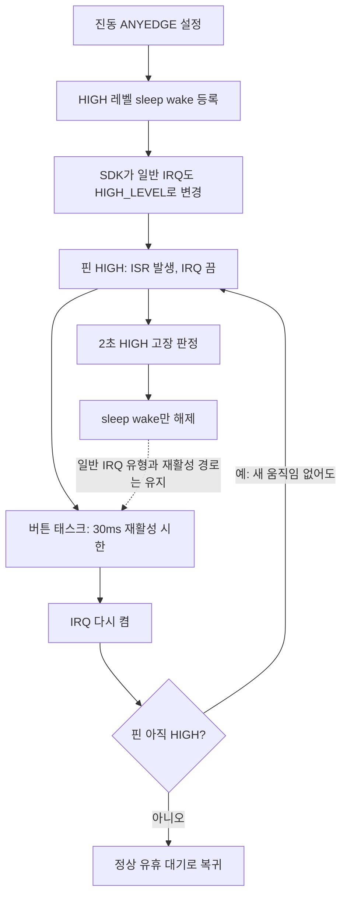
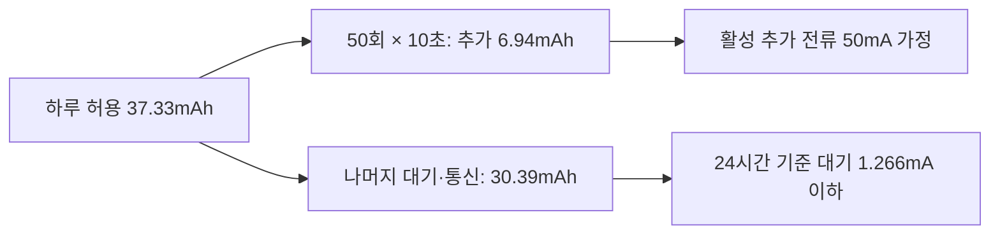
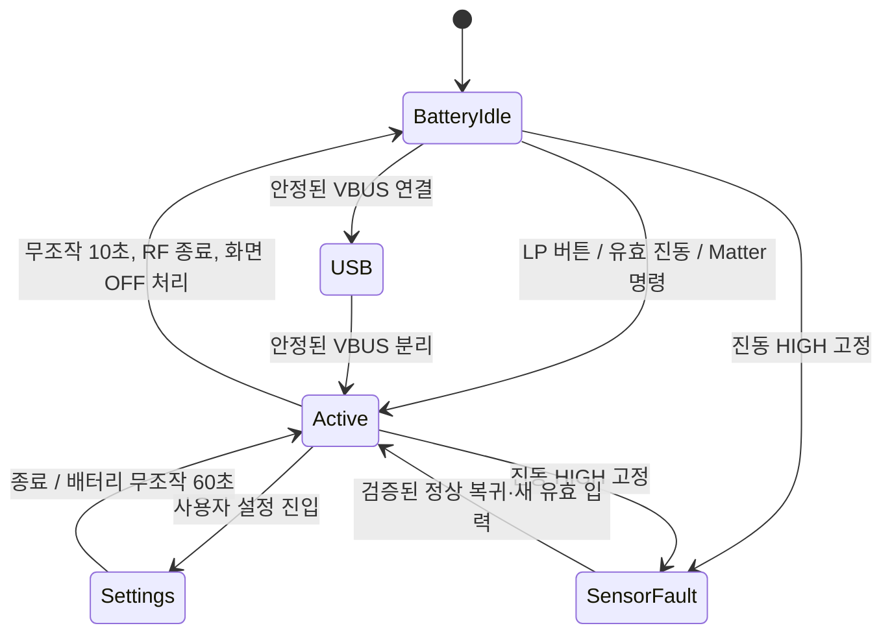

# 절전 로직 재감사 — 2026-10-19

대상: XIAO ESP32-C6 / Thread·Matter / CC1101 447MHz / LP I2C PCF8575 / I2C OLED / 700mAh.

**가장 먼저 고칠 부분은 진동 GPIO의 인터럽트 유형 충돌이다.** 버튼 대기·화면·메인 루프 개선은 확인됐지만, 진동을 엣지로 센다는 전제가 SDK 호출 뒤에는 성립하지 않는다. HIGH가 유지되면 새로운 움직임 없이도 30ms 재활성 경로가 반복될 수 있다. 따라서 “웨이크를 해제했으니 고장 상태의 반복 기상도 끝났다”는 판단은 현재 코드로 보장되지 않는다.

15일 목표도 아직 검증되지 않았다. **기상 횟수 87% 감소는 전체 소비 전류 87% 감소를 뜻하지 않는다.** 최신 최종 변경 후 저장된 배터리 시험은 55초의 움직임·화면 유지 확인이며, 장시간 정지 대기나 직접 전류 측정 결과가 아니다.

## 1. 범위와 근거

- 기준 HEAD: `e9ed0b57975089fd16d79d2155598ac71a8c4485`.
- `main`의 자체 펌웨어 42개 텍스트 파일을 이전 전체 감사의 SHA-256과 대조했다. 구현 13개 C/C++ 파일은 현재 총 16,206줄이다. 폰트·헤더·보드·LP 프로그램·빌드 정의도 목록에 포함했다.
- 이전 감사와 동일한 35개 파일은 당시 전체 검토를 유지하고, 변경된 7개 파일의 제어 흐름과 연결된 기존 경로를 재검토했다: `app_main.cpp`, `button_handler.c/.h`, `oled_ui.c/.h`, `somfy_app.c`, `somfy_config.h`.
- 관련 빌드 설정, 실제 `build-xiao-c6/config/sdkconfig.h`, SmartThings Lua 명령 경로, 저장된 NVS·로그·해석 도구를 추가 확인했다. 일반 `build/`의 설정은 XIAO 설정과 다르므로 사용하지 않았다.
- 설치된 ESP-IDF 5.5.5의 GPIO·ADC·PM 구현을 직접 대조했다. 모든 외부 SDK 코드를 전수 감사했다는 의미는 아니다. CAD·백업·과거 바이너리는 실행 경로 검토 대상에서 제외했다.
- 펌웨어·설정·기존 도구는 수정하지 않았다. 빌드·플래시·시리얼 연결·새 실기 측정도 하지 않았다. 새 보고서와 오프라인 계산 자료만 작성했다.

검토 목록: [source_snapshot.json](D:/dev/workspaces/somfy-blinds-things-by-claude/doc/assets/power_saving_reaudit_2026-10-19/source_snapshot.json).
계산 결과: [audit_data.json](D:/dev/workspaces/somfy-blinds-things-by-claude/doc/assets/power_saving_reaudit_2026-10-19/audit_data.json).

## 2. 반영된 개선과 남은 문제

| 이전 항목 | 현재 판단 | 이번 확인 |
|---|---|---|
| F01 ADC 상주·도메인 유지 | 남음, 효과량 미확정 | 기본 ADC 상주는 유지된다. 무조건 삭제하면 된다는 뜻은 아님 |
| F02 TOP 차단·핀 보존 | 실험 경로 일부 대응 | SPI/RMT retention은 이전 감사 때부터 확인됨. LP 오류 시 HP 핀 인계는 여전히 불완전 |
| F03 디바운스 대기 | 개선 확인 | 미확정 입력의 남은 20ms 시한을 대기에 반영 |
| F04 이중 대기 | 해결 확인 | LP 대기 직후 `continue`; 공통 10ms 대기를 다시 하지 않음 |
| F05 HP가 깨어 있을 때 LP 통지 | 개선 확인 | idle hook이 `seq` 변화를 통지. 유휴 백업 1,000ms. idle 실행을 기다리는 구조적 한계는 있음 |
| F06 짧은 탭 보존 | 일반 버튼 개선 | `s_lat_hold`를 확정까지 유지. 로터리 푸시는 별도 경로 |
| F07 로터리 잔량 | 개선 확인 | 남은 회전을 30ms 간격으로 전달. ±8 상한과 역방향 상쇄 정책은 유지 |
| F08 공유 RAM 경합 | 부분 해결 | 로터리는 LP 누적값−HP 소비값으로 변경. **버튼 래치는 양 코어 RMW 유지** |
| F09 진동 처리 | 미완료 | 시간 기준은 개선됐으나 **IRQ 유형 덮어쓰기·고장 뒤 재활성 반복**이 남음 |
| F10 유휴 태스크 | 개선 확인 | main 1초, OLED OFF 5초, hold idle 5초 + 통지. 진동 때는 별도 30ms 시한 |
| F11 ADC·진단 저장 | 대부분 유지 | ADC 5초, PM 기록 60초, batlog 정상 120초, 시간 저장 5분 |
| F12 BATLOG와 LP 통지 결합 | 해결 확인 | BATLOG=0 최소 콜백에도 ULP/GPIO 통지가 존재 |
| F13 콜백에서 OLED I2C 수행 | 개선 확인 | 일반 ON/OFF는 UI 태스크에 요청. 입력·Matter 경로의 직접 전송 감소 |
| F14 OFF 성공 확인 | 부분 개선 | 실제 명령 결과·재시도 추가. 일반 `panel_on`은 아직 **요청한 논리 상태** |
| F15 설정 화면 상시 유지 | 정책 반영 | 배터리 60초 자동 종료, 주파수 화면 상태 맞춤, 등록된 페어링 메뉴 5초 복귀 |
| F16 USB 판정 불일치 | 개선 확인 | PM·화면·기록이 안정화된 물리 판정을 공유 |
| F17 Thread/SNTP | 개선 확인 | 연결 이벤트와 보험 조회, SNTP 조건부 실행, DNS64. 수신 주기 연장은 하지 않음 |
| F18 해석·증거 문제 | 남음 | 기상 비용 중심값 불일치, 세션 혼합, 실패한 절전도 콜백 계측에 포함되는 문제 |

위 표의 “개선”은 코드상 경로 확인이다. 전류·지연의 실기 수치가 모두 확정됐다는 뜻은 아니다. 사용자 지정인 설정 60초, 등록 기기 페어링 메뉴 처리, 진동 고장 후 60초 인정 정책은 그대로 전제로 삼았다.

## 3. 우선순위 1 — 진동 IRQ가 실제로는 HIGH 레벨로 바뀐다

### N01 [P1, 코드·SDK로 확인] 엣지 카운터가 같은 HIGH를 반복해서 셀 수 있다

연결된 호출 순서는 다음과 같다.

1. [button_handler.c:1419](D:/dev/workspaces/somfy-blinds-things-by-claude/main/button_handler.c:1419): 진동 IRQ를 `GPIO_INTR_ANYEDGE`로 설정한다.
2. [somfy_app.c:5613](D:/dev/workspaces/somfy-blinds-things-by-claude/main/somfy_app.c:5613): `_arm_level_wake(VIBE_PIN, GPIO_INTR_HIGH_LEVEL, ...)`를 호출한다. 정상 LOW일 때 웨이크를 등록한다.
3. [somfy_app.c:782](D:/dev/workspaces/somfy-blinds-things-by-claude/main/somfy_app.c:782): `gpio_wakeup_enable()` 실행.
4. ESP-IDF 5.5.5 [gpio.c:667](D:/dev/workspaces/esp-idf/components/esp_driver_gpio/src/gpio.c:667)는 이 함수에서 **일반 GPIO IRQ의 intr_type도 HIGH_LEVEL로 쓴다**. LP wake만 설정하는 함수가 아니다. [공식 소스](https://github.com/espressif/esp-idf/blob/v5.5.5/components/esp_driver_gpio/src/gpio.c#L650-L699).
5. ISR은 IRQ를 끄고 카운터를 증가시킨다([button_handler.c:1572](D:/dev/workspaces/somfy-blinds-things-by-claude/main/button_handler.c:1572)). 태스크는 30ms 뒤 다시 켠다([1089행](D:/dev/workspaces/somfy-blinds-things-by-claude/main/button_handler.c:1089)).
6. 핀이 계속 HIGH면 IRQ를 켜자마자 같은 레벨로 다시 인터럽트가 걸릴 수 있다. 새 엣지가 없어도 카운터가 증가한다.

**특히 고장 처리 뒤에도 반복 경로가 남는다.** [button_handler.c:1696](D:/dev/workspaces/somfy-blinds-things-by-claude/main/button_handler.c:1696)의 `gpio_wakeup_disable()`는 SDK에서 wake enable만 해제하며 일반 IRQ 유형을 ANYEDGE로 되돌리지 않는다. 이어지는 30ms IRQ 재활성도 중단하지 않는다. 고장 후 60초가 지나면 화면 유지용 인정만 끝나고, IRQ 재활성 타이머는 계속 남을 수 있다.

따라서 현재 “엣지만 60초 인정”은 진짜 물리 엣지만 인정하는 동작이 아니다. 정상적으로 움직이는 중 높은 듀티의 HIGH를 반복 감지한 현상도 이 설정 충돌의 영향을 받았을 가능성이 있다. 과거 기록의 33회/초를 센서 잡음의 확정 증거로만 해석해서는 안 된다.

**수정 방향:** 일반 동작 중 물리 엣지 감지와 sleep wake 조건을 분리해 설계하고, 고장 상태에서는 같은 HIGH에 대해 30ms 재활성 시한이 무한 반복되지 않게 해야 한다. C6의 LP wake 기능과 일반 GPIO IRQ의 설정 관계를 함께 검증해야 한다. 단순히 `gpio_set_intr_type(ANYEDGE)`를 뒤에 한 줄 추가하면 wake 조건까지 바꿀 수 있어, 검증 없는 한 줄 처방은 권하지 않는다. 고장 후 60초 인정 정책 자체를 바꿀 필요는 없다.

**확보량:** 정지 HIGH에서 약 30~33회/초의 재활성 루프를 제거할 여지가 있다. 이 기기의 실제 추가 전류는 미측정이다. 뒤의 약 30µC/회 추정이 같은 조건에 적용된다는 가정에서만 약 0.9~1.0mA, 하루 21.6~24mAh 규모다. **이 값은 정상 LOW 대기의 추가 절감량이 아니며, 다른 기상 절감과 중복 합산하면 안 된다.**

### N02 [P2, 코드로 확인] HP가 이미 깨어 있을 때 진동 전달은 여전히 통지되지 않는다

[진동 ISR](D:/dev/workspaces/somfy-blinds-things-by-claude/main/button_handler.c:1562)은 카운터만 올리고 버튼 태스크에 통지하지 않는다. GPIO wake가 성공한 절전 복귀에서는 [somfy_app.c:3147](D:/dev/workspaces/somfy-blinds-things-by-claude/main/somfy_app.c:3147)의 통지가 있으므로 일반 sleep wake는 개선됐다.

그러나 HP가 다른 작업으로 이미 깨어 있거나 진동 wake를 고장 처리로 꺼 둔 상태라면 그 복귀 콜백에 의존할 수 없다. LP idle hook도 PCF의 `seq`만 감시한다. 이때 버튼 태스크가 유휴 대기에 들어가 있으면 첫 진동 판정은 **다음 통지나 최대 약 1초 백업 대기**까지 늦어질 수 있다. 30ms 재활성 시한은 ISR 발생 전에 이미 시작한 1초 대기를 자동 변경하지 않는다.

**수정 방향:** N01을 해결한 뒤 첫 유효 진동을 버튼 태스크로 전달하는 통로를 명시한다. 무제한 ISR 통지를 먼저 넣으면 레벨 반복을 더 빨리 처리하는 구조가 될 수 있다. 목적은 반응 유지이며, 전류 절감 수치를 별도로 약속할 항목은 아니다.

추가 예외: 부팅 시 핀이 이미 HIGH라 `_arm_level_wake()`가 등록을 건너뛴 뒤, 2초 고장 판정 전에 LOW로 복귀하면 정상 상태 전이에서 웨이크를 새로 거는 경로가 없다. 부팅 당시의 일시 HIGH와 이후 정상 복귀도 확인해야 한다.

## 4. 우선순위 2 — 측정값이 가리키는 구간과 의미를 바로잡아야 한다

### N03 [P1, 원시 자료 재계산] 최종 펌웨어의 장시간 정지 대기 결과가 없다

| COM7 저장 자료 | batlog 현재 세션 | 콜백 진입 계측/초 | 해석 가능한 범위 |
|---|---:|---:|---|
| 10/18 18:15 `btnday` | 24,727초, #62 | 20.19 | 버튼 1차 개선 후 장시간 자료 |
| 10/18 20:10 `mainrun` | 2,652초, #64 | **4.18** | F13/F16/F17·DNS64·최종 진동 변경 **이전**의 개선 증거 |
| 10/18 21:21 `after_f13f16f17` | 118초, #65 | 27.00 | 짧은 기능 시험. 정지 대기 기준으로 부적절 |
| 10/18 23:53 `after_battest` | **55초, #66** | **106.98** | 움직이는 동안 화면 유지 확인. 장시간 대기 전력 아님 |

COM8의 20:10 자료는 #36, 2,757초, 32.26회/초다. **이전 단계의 COM7 4.18 대 COM8 32.26 비교는 저장 자료에 존재한다.** 하지만 23:53 COM8 덤프에도 같은 #36·2,757초 값이 남아 있다. 파일 저장 시각이 최신이라는 이유로 최종 변경과 동시 시험한 새로운 대조군으로 취급하면 안 된다.

또한 batlog 링에는 이전 세션 표본이 함께 있다. 20:10 텍스트 전체 표본의 첫·끝 전압이 4,136→4,158mV인 것을 44분 방전량으로 계산하면 틀린다. 링 전체 평균·최초 전압·최종 전압을 그대로 배터리 수명으로 환산하지 않는다.

근거: [20:10 COM7 텍스트](D:/dev/workspaces/somfy-blinds-things-by-claude/logs/batlog_COM7_1018_mainrun.txt), [COM7 최종 덤프](D:/dev/workspaces/somfy-blinds-things-by-claude/logs/nvs_COM7_1018_2353_after_battest.bin), [COM8 최종 덤프](D:/dev/workspaces/somfy-blinds-things-by-claude/logs/nvs_COM8_1018_2353_after_battest.bin).

### N04 [P2, SDK로 확인] batlog의 “절전 진입”에는 거부된 시도도 섞인다

[somfy_app.c:3117](D:/dev/workspaces/somfy-blinds-things-by-claude/main/somfy_app.c:3117)은 복귀 콜백의 경과 시간이 양수면 `s_ls_count`와 `s_ls_total_us`를 증가시킨다.

IDF [pm_impl.c:877](D:/dev/workspaces/esp-idf/components/esp_pm/pm_impl.c:877)는 성공·거부를 구분해 SDK 카운터를 증가시키지만, **거부된 경우에도 경과 시간을 재서 exit callback을 실행한다**. 따라서 앱의 콜백 count·sleep%는 하드웨어가 성공적으로 잠든 횟수·시간과 동일하지 않다. `pdcnt` 역시 성공만의 횟수가 아니다.

최종 COM7의 PM 차분은 약 60.04초 동안 성공 2,232회, 거부 4,408회다. **시도 중 약 66.4%가 거부**됐다. 움직임·화면 ON 시험에서 나온 값이므로 정지 상태에서도 항상 이렇다고 단정하지 않는다. 다만 앱의 55초 5,884회 계측을 전부 성공한 sleep으로 설명하면 안 된다. 두 기록의 시간 창도 서로 다르다.

`locks0`의 별도 문제도 있다. [somfy_app.c:3193](D:/dev/workspaces/somfy-blinds-things-by-claude/main/somfy_app.c:3193)의 `s_pm0_done`은 **부팅 후 최초 1회**이며 USB를 뺐다 다시 꽂아도 세션별 재설정되지 않는다. 20:10 COM7에서 PM 창은 3,337초, batlog 세션은 2,652초로 다르다. 해석기의 “배터리 구간만”이라는 표시는 모든 USB 재연결 상황에서 보장되지 않는다.

**수정 방향:** 성공·거부·콜백 경과를 나누고, 배터리 세션 시작/끝에 같은 기준점으로 차분을 남긴다. 펌웨어 ID와 실제 IRQ 유형, 화면 요청/명령 성공, 정지/움직임 여부도 같이 기록해야 비교가 가능하다. 이 정리는 자체적으로 며칠을 확보하는 변경이 아니라, 잘못된 결론을 막는 우선 작업이다.

### N05 [P2, 재계산] “기상 비용 1.6mA·50µC”를 확정값으로 쓰면 안 된다

실제 배터리 실험인 [10/18 07:51 `wakenight`](D:/dev/workspaces/somfy-blinds-things-by-claude/logs/nvs_COM7_1018_0751_wakenight.bin)은 `dry=0`, ABACA 5단계, 단계당 3,600초다. 현재 해석기 계산을 다시 실행하면:

| 항목 | 재계산 결과 |
|---|---:|
| B: 추가 기상 단계 전압 편차 | 1.617mV |
| C: CC1101 IDLE 추가 부하 편차 | 2.884mV |
| 비율 B/C | 0.5606 |
| 1.7mA × 비율 | **0.953mA** |
| B 단계 기상 속도 | 31.779회/초 |
| 회당 추가 전하 추정 | **29.99µC/회** |
| 도구의 가정하 95% 범위 | 0.431~1.641mA |

커밋 설명의 약 1.6mA(1.4~1.9), 코드 주석의 약 50µC는 이 저장 자료를 현재 식으로 계산한 중심값과 일치하지 않는다. **1.64mA는 현재 계산의 상단 범위에 가깝고 중심값이 아니다.**

이 0.953mA도 전류계 실측은 아니다. CC1101 IDLE 1.7mA는 [TI 데이터시트의 전형값](https://www.ti.com/lit/ds/symlink/cc1101.pdf)이다. 칩 공급 레일과 배터리 입력의 차이, 전원 효율, 셀 완화와 곡률, B/C 부하 파형의 차이가 남는다. 도구의 ±20% 가정으로 모든 불확실성이 검증됐다고 볼 수 없다. 이 실험은 무선 시작 전의 모사 기상이며, 실제 앱·Thread 기상 비용이 항상 같다는 증거도 아니다.

또한 [pmdump_decode.py:19](D:/dev/workspaces/somfy-blinds-things-by-claude/sim/tools/pmdump_decode.py:19)의 2.52ms 고정비용을 sleep 시간 밖에 별도로 더하면, 이미 `esp_light_sleep_start()` 호출 경과에 포함된 전환 구간을 중복 해석할 수 있다. sleep%·기상 횟수만으로 mA를 결정하지 않는다.

## 5. 우선순위 3 — 공유 입력과 장애 복구

### N06 [P2, 코드로 확인] 버튼 래치는 여전히 양 코어가 수정한다

LP의 [pcf_poll.c:174](D:/dev/workspaces/somfy-blinds-things-by-claude/main/lp_core/pcf_poll.c:174)는 `press_latch |= ...`, HP의 [button_handler.c:724](D:/dev/workspaces/somfy-blinds-things-by-claude/main/button_handler.c:724)는 `ulp_press_latch &= ~lat`를 수행한다. volatile 32비트 접근이 각각 가능해도 이 읽기→수정→쓰기 전체가 원자적이지는 않다.

가능한 순서:

| 순서 | 공유 래치 |
|---|---:|
| A 버튼 래치가 남아 있음 | `01` |
| HP가 clear 계산용 값을 읽음 | HP 임시값 `01` |
| LP가 B 버튼 래치를 추가 | `11` |
| HP가 옛 임시값에서 A를 뺀 결과 저장 | **`00`: B 손실** |

반대로 LP의 옛 OR 결과가 HP의 clear를 되돌리는 순서도 가능하다. 일반 버튼의 `s_lat_hold` 개선은 이미 가져온 입력을 보존하지만, 가져오기 전 공유값의 경합까지 해결하지 않는다. 실제 빈도는 미측정이다.

**수정 방향:** 버튼별 LP 생산 카운터·HP 소비 카운터 또는 소유권이 분리된 이벤트 전달을 사용한다. HP 임계구역만으로 LP 실행까지 정지한다고 가정하면 안 된다. 누락률이 낮아도 이 문제를 해결하지 않은 채 백업 폴링을 더 길게 만들면 재현이 어려워진다. 절감 mA보다 반응 신뢰성 확보가 목적이다.

로터리 푸시는 [1031행](D:/dev/workspaces/somfy-blinds-things-by-claude/main/button_handler.c:1031)의 별도 즉시 PRESS/CLICK 경로이며 일반 버튼의 20ms 디바운스·확정 보존 목록에 포함되지 않는다. 일반 버튼 시뮬레이션 통과를 STOP/MY 접점 바운스 검증으로 확대하면 안 된다.

### N07 [P2, 코드상 복구 누락] LP 정지 뒤 HP 비트뱅 인계가 완결되지 않는다

[button_handler.c:735](D:/dev/workspaces/somfy-blinds-things-by-claude/main/button_handler.c:735)는 LP 정지를 감지하면 `ulp_enabled=0`, `s_lp_active=false` 뒤 HP 읽기로 넘어간다. 그러나 LP-I2C가 점유한 GPIO6/7을 정상 HP GPIO로 되돌리는 인계 절차가 보이지 않는다. SDK LP-I2C 초기화는 `rtc_gpio_init()`을 수행한다. HP 폴백은 일반 `gpio_set_direction()`·`gpio_get_level()`을 사용한다.

따라서 “폴백으로 전환” 로그만으로 버튼 복구를 보장할 수 없다. LP 시작 도중 실패한 경로에도 같은 점검이 필요하다. **LP 정지 확인 → 진행 중 버스 작업 정리 → 핀·I2C 소유권 전환 → PCF 재검출 → 실패 시 제한된 재시도/오류 상태**까지 명시해야 한다. 새 버스 오류를 실기에서 주입하지 않았으므로 실제 실패 양상·전력은 미확정이다.

## 6. 남은 정상 대기 소비

### N08 [전력 개선 후보, 비용 미측정] 화면 OFF 뒤에도 측정·저장이 돈다

| 경로 | 현재 코드상 주기/조건 | 줄일 경우 확보 가능한 작업량 |
|---|---|---|
| 배터리 ADC | [somfy_app.c:5917](D:/dev/workspaces/somfy-blinds-things-by-claude/main/somfy_app.c:5917), 약 5초 | OFF에서 60초라면 명목 17,280→1,440회/일, **91.7% 감소** |
| PM 덤프 | [6536행](D:/dev/workspaces/somfy-blinds-things-by-claude/main/somfy_app.c:6536), 배터리 중 약 60초 | 600초라면 해당 저장 약 1,440→144회/일, **90% 감소** |
| batlog | 정상 120초, 시작 120초 동안 5초, 버튼 이벤트 별도 | 정상 주기만 약 720회/일. 2초 flush는 dirty일 때만 실행되므로 매 2초 저장 아님 |
| batlog 저장 단위 | [3269행](D:/dev/workspaces/somfy-blinds-things-by-claude/main/somfy_app.c:3269), 링 전체 3,300B+메타데이터 | 표본 1개 추가에도 전체 blob 저장. 증분/배치로 쓰기량 축소 가능 |
| 시간 저장 | [2543행](D:/dev/workspaces/somfy-blinds-things-by-claude/main/somfy_app.c:2543), 5분 | 명목 288회/일. 시각 점프 오탐 개선은 반영됨 |

각 작업은 이미 깨어난 메인 루프에 얹히기도 하므로, 작업 횟수 감소율이 전체 배터리 감소율은 아니다. ADC 측정 주기를 줄여도 기본 상주 ADC의 도메인 유지 요청은 사라지지 않는다. 회당 배터리 입력 전하를 재야 일수로 환산할 수 있다.

기본 상주 ADC는 [somfy_app.c:2652](D:/dev/workspaces/somfy-blinds-things-by-claude/main/somfy_app.c:2652)에서 `adcfix=0`을 선택한다. 설치 SDK [adc_oneshot.c:174](D:/dev/workspaces/esp-idf/components/esp_adc/adc_oneshot.c:174)는 해당 조건에서 MODEM/TOP을 ON으로 요청한다. 이 경로는 여전히 존재한다.

그러나 이전 실험에서 ADC 유닛을 해제하는 방식은 Thread 정지와 함께 기록돼 있다. **`adcfix=1`을 바로 운영 해법으로 추천하지 않는다.** 기존 MODEM/TOP/LP 전압 실험에서 큰 차이를 검출하지 못했다고 소비가 정확히 0이라는 뜻도 아니다. 이전 감사에서 계산 구간·오차의 한계를 이미 다뤘다. 도메인 이름만 보고 남은 소비 전부를 ADC 탓으로 돌리는 것도 근거가 부족하다.

LP 코어는 현재 `SOMFY_LP_HALT=1`, LP 타이머 약 5ms로 PCF를 읽는다. 단순 busy-loop로 계속 도는 설정은 아니다. 입력 반응을 지키려면 LP 주기를 무조건 늘리기보다, 필요 시 INT·짧은 연속 스캔·로터리 샘플링을 결합하는 설계를 검토한다. 현재 자료로 LP 쪽 변경이 몇 mA를 보장하는지는 말할 수 없다.

### N09 [P2, 관측 한계] OLED OFF 요청과 실제 OFF 상태는 다르다

[oled_ui.c:3348](D:/dev/workspaces/somfy-blinds-things-by-claude/main/oled_ui.c:3348)의 `s_panel_on`은 요청 즉시 바뀐다. UI 태스크가 OFF 명령을 보내기 전에도 로그는 OFF로 읽힐 수 있다. 명령 실패 시 재시도는 추가됐지만, `s_oled_present=false`면 [2952행](D:/dev/workspaces/somfy-blinds-things-by-claude/main/oled_ui.c:2952)의 전송을 건너뛴다. SCREENSAVER는 렌더·flush를 하지 않으므로 평상시 flush 기반 재검출도 이 상태에서는 진행되지 않는다.

**수정 방향:** 요청 상태·마지막 ACK 성공 상태·미확인을 구분하고, OFF 실패/패널 유실 시 제한된 복구 정책을 둔다. ACK 성공도 모듈 전체의 전원 차단이나 실제 소비 전류 측정은 아니다. [231행](D:/dev/workspaces/somfy-blinds-things-by-claude/main/oled_ui.c:231)의 비트뱅 write는 뮤텍스 대기 실패 후에도 전송을 계속하므로, 복구·ADC 경합 시 전송 신뢰성도 함께 정리할 여지가 있다.

정상적으로 꺼지는 장치의 추가 절감량은 없을 수 있다. 실패 때문에 실제 패널이 계속 켜져 있다면 영향은 매우 클 수 있으나, 현재 이 장치에서 그런 실패가 발생했다는 직접 증거는 없다.

## 7. 15일 예산 — 수정하면 얼마나 확보되는가

### 7.1 먼저 맞춰야 할 수치

가용 용량을 **700mAh × 80% = 560mAh**로 가정한다. 80%는 측정 결과가 아닌 계산 여유다.

- 15일 허용 총량: **37.33mAh/일 = 전체 평균 1.556mA**.
- 700mAh 전부를 쓸 수 있어도 전체 평균 1.944mA 이하여야 한다.
- 모든 전류는 배터리 입력 기준이어야 한다. 3.3V 레일의 전류를 그대로 배터리 mAh에 넣지 않는다.

화면 사용 중 **장치 전체의 추가 소비가 대기보다 50mA 높다**고 가정한 예시다. OLED 단독 사양·현재 장치의 실측값이 아니다. RF 등 추가 활동이 여기 포함되지 않으면 별도로 더해야 한다.

| 하루 사용 | 화면 10초씩의 총시간 | 추가 사용량/일 | 15일 예산 중 사용 | 남겨야 할 정상 대기 전류 상한 |
|---:|---:|---:|---:|---:|
| 20회 | 200초 | 2.78mAh | 7.4% | **1.440mA** |
| 50회 | 500초 | 6.94mAh | 18.6% | **1.266mA** |

**10초는 최대 하루 화면 시간 제한이 아니다.** 현재 코드는 진동 때 활동 시각을 갱신하므로, 들고 움직이는 시간 내내 화면이 유지될 수 있다. 버튼 20~50회보다 실제 화면 ON 총시간을 기록해야 한다. 위 50mA 가정에서 15분 ON은 추가 12.5mAh/일, 1시간 ON은 50mAh/일이다. 후자는 화면 추가분만으로 하루 예산을 넘는다. 움직이는 동안 화면 유지가 요구사항이면 그 시간을 배터리 예산에 포함해야 한다.

### 7.2 정상 대기 전류별 사용 시간

560mAh·활성 추가 50mA·10초·하루 20~50회 가정. **현재 장치의 예상 수명 측정값이 아니라 목표 비교표다.**

| 화면 OFF 정상 대기 전류 | 하루 20회 사용 | 하루 50회 사용 | 15일 판단 |
|---:|---:|---:|---|
| 1.0mA | 20.91일 | 18.10일 | 여유 있음 |
| 1.2mA | 17.73일 | 15.67일 | 50회에도 근접 여유 |
| 1.3mA | 16.48일 | 14.68일 | 사용량에 따라 미달 |
| 1.5mA | 14.44일 | 13.04일 | 순수 대기 15.56일이어도 실사용 미달 |
| 2.0mA | 11.03일 | 10.19일 | 정상 대기 소비를 더 줄여야 함 |
| 3.0mA | 7.49일 | 7.09일 | 주기 몇 개 추가 제거만으로는 격차가 큼 |

### 7.3 수정 후보별 확보량과 한계

| 수정 후보 | 확보량 계산 | 배터리·대기시간 효과 | 확실성 |
|---|---|---|---|
| **N01 HIGH 재인터럽트 루프 차단** | 문제 발생 중 약 30~33회/초 경로 제거 여지 | 30µC/회 적용 가정에서 **0.9~1.0mA, 21.6~24mAh/일**. 정상 LOW 유휴에는 같은 이득 없음 | 경로 확인, mA 미측정 |
| 이미 반영된 약 32.26→4.18회/초 | 차이 28.08 × 29.99µC | 조건부 **0.842mA, 20.21mAh/일**. 과거 4.56mA 모델을 기준으로만 비교하면 약 18.5% 소비 감소, 순수 대기 5.12→6.28일 | 횟수는 이전 단계 실기, 전류는 교정 모형, 현재 수명 예측 아님 |
| 정상 유휴 main 1초·btn 1초를 더 줄임 | 각 1회/초가 독립 CPU 기상이라는 가정 | 합계 최대 약 **0.060mA, 1.44mAh/일**의 단순 모형. 이미 동시 기상하면 더 작음 | 조건부, USB·WDT·복구 시한 고려 |
| OLED OFF·hold 5초 백업도 제거 | 0.2+0.2회/초 가정 | 약 **0.012mA, 0.29mAh/일**. 위 두 태스크와 합쳐도 약 0.072mA | 조건부, 통지 누락 안전망 필요 |
| 정상 4.18회/초를 전부 0으로 만듦 | 비현실적인 상한 비교 | 같은 모형에서 **0.125mA, 3.01mAh/일**. Thread 유지 중 실제 0회는 목표가 아님 | 기상 줄이기만의 규모 비교 |
| OFF ADC 5→60초 | 측정 횟수 91.7% 감소 | `15,840 × 회당 추가 전하(µC) ÷ 3,600,000` mAh/일. 예: 회당 100µC면 **0.44mAh/일** | 회당 100µC는 예시. 상주 전류는 별도 |
| PM 저장 60→600초 | 해당 저장 약 90% 감소 | `1,296 × 회당 추가 전하(µC) ÷ 3,600,000` mAh/일. 예: 회당 1,000µC면 **0.36mAh/일** | 회당 1,000µC는 예시. 다른 NVS 작업은 남음 |
| ADC 수명·도메인 유지 해결 | 정상 Thread·핀 유지 조건의 차분 필요 | 현재 몇 mA·며칠인지 미확정. 불안정했던 `adcfix=1`의 단독 적용 제외 | 유지 요청 확인, 절감량 미확정 |
| OLED 10→5초 | 위 활성 50mA 가정 | **1.39~3.47mAh/일**. 사용자 요구를 지키려면 우선 변경 대상에서 제외 | 조건부 |
| 불필요 진동으로 생긴 화면 ON 10분/일 제거 | 추가 50mA × 600초 | **8.33mAh/일**. 올바른 움직임까지 무시하는 변경은 제외 | 시간·전류 가정 |
| 실제 대기 전류 2.0→1.2mA 확보 | 원인과 무관하게 0.8mA 감소 | 20회: **11.03→17.73일**, 50회: **10.19→15.67일** | 목표 민감도, 특정 변경의 보장 효과 아님 |

위 행들은 서로 중복되므로 합계를 내면 안 된다. 정상 유휴와 HIGH 고장 상태를 분리해야 한다. 과거 4.56mA도 전압 기반 모델이며 현재 빌드의 새 직접 측정값이 아니다. 특히 이미 이뤄진 32→4회 개선을 앞으로 확보할 추가 이득으로 다시 더하지 않는다.

## 8. 내가 정리한다면 적용할 구조

| 상태 | 즉시 필요한 것 | 예약할 시한 | 전력 평가 |
|---|---|---|---|
| 정상 배터리 대기 | LP 입력·첫 유효 진동·Matter 수신 통지 | USB 확인·WDT·최소 복구·묶은 진단 시한 | 정상 대기 평균 전류 |
| 활동 중 | 디바운스·회전 잔량·RF 종료 | 입력 확정, 재전송 종료, 화면 OFF | 회당 추가 전하·실제 ON 시간 |
| 센서 고장 | 정상 복귀 근거·다른 버튼 | 제한된 복구 확인. HIGH IRQ의 무한 30ms 재활성 제외 | 고장 유지 시 평균 전류·정상 복귀 시간 |
| USB | 콘솔·충전 표시 | 기존 사용자 정책 | 배터리 시험과 구간 분리 |
| 설정·페어링·OTA | 각 기능의 진행 이벤트 | 사용자 지정 60초와 명시된 예외 | 정상 유휴 통계와 분리 |

OLED·RF·PM·입력 태스크를 한 태스크로 합칠 필요는 없다. 각 상태의 이벤트 전달과 다음 필수 시한을 명확히 하고, 입력 보존을 먼저 보장한 뒤 남은 주기 작업을 묶는 편이 적절하다. **Thread slow poll 7,000ms / fast poll 200ms는 이번 절감 수단에서 유지한다.** 코드의 “slow-poll=5s” 로그는 현재 설정과 맞지 않는다. Deep-sleep이나 CSL로 바꾸는 제안도 현재 SmartThings 지연 유지 조건의 해법으로 채택하지 않았다.

## 9. 다음 수정·검증 순서

| 순서 | 수정/확인 대상 | 통과 기준 | 기대하는 결과 |
|---:|---|---|---|
| 1 | N01 GPIO IRQ/wake 설정 충돌 | 등록 후 실제 IRQ 유형 확인. LOW 정지, HIGH 고정, 실제 진동을 각각 시험 | HIGH 고정에서 새 움직임 없는 ISR 카운트·30ms 루프가 계속되지 않음 |
| 2 | N02 진동 통지·고장 복귀 | HP 활동 중 짧은 진동, sleep 중 진동, 부팅 HIGH 후 정상화, 60초 뒤 복귀 | 현재 체감 지연 유지, 의도한 고장 정책 성립 |
| 3 | N06 래치와 N07 LP 장애 인계 | HP/LP 경합 순서·짧은 탭·MY 접점, LP/I2C 정지 후 복구 | 백업 주기를 늘려도 입력 누락/버스 소유권 충돌 없음 |
| 4 | N03~N05 측정 정리 | 펌웨어 ID·동일 세션 기준·성공/거부·실제 화면 상태 구분 | 4.18회와 최신 55초 기록을 섞지 않음 |
| 5 | 최종 코드 정지 배터리 시험 | 기존 수신 지연을 유지하고 배터리 입력 전류·전하를 장시간 적산 | 정상 유휴가 목표 약 1.27~1.44mA 예산에 들어오는지 확인 |
| 6 | N08 측정·저장 주기 정리 | 배터리 표시 수렴·무배터리 감지·복구와 관찰 가능성 유지 | 작업 비용의 실제 차분 확보 |
| 7 | 20~50회와 실제 이동 시간 포함 | 실제 ON 시간, RF 횟수, 명령 지연·손실률, 하루 적산 | 전체 37.33mAh/일 이하 또는 유효 15일 방전 시험 |

기존 `vibe_stuck_edge_sim.py`는 실행 시 통과한다. 그러나 모델은 외부 엣지 또는 별도로 지정한 잡음이 있어야 ISR을 증가시키며, **wake 설정이 ANYEDGE를 HIGH_LEVEL로 덮어쓰는 SDK 부작용을 모델링하지 않는다.** 그래서 통과해도 N01의 반례를 배제하지 못한다. 실제 고장 상태의 반복 기상까지 측정해야 한다.

이번 오프라인 검산은 원시 NVS 20개를 다시 읽어 세션별 수치를 추출하고, 버튼 래치 경합과 HIGH 레벨 재활성의 가능한 반례를 남겼다. 기존 `btn_lp_wait_sim.py`, `oled_req_sim.py`, `vibe_stuck_edge_sim.py`도 재실행해 통과를 확인했다. 모델 통과는 SDK 부작용이나 실기 전력까지 검증한 결과가 아니다. 이번에 실기에서 동일 현상을 재현했다는 주장도 아니다. 재현 도구: [audit_offline.py](D:/dev/workspaces/somfy-blinds-things-by-claude/doc/assets/power_saving_reaudit_2026-10-19/audit_offline.py).

**현 단계의 결론:** 개선은 실제로 이뤄졌다. 다만 진동 IRQ/wake의 설정 충돌을 우선 바로잡고 최종 빌드의 정지 전류를 다시 확인해야 한다. 버튼 감지를 느리게 만들거나 1초 백업을 더 늘리는 것만으로 15일을 확보한다고 볼 근거는 없다.
