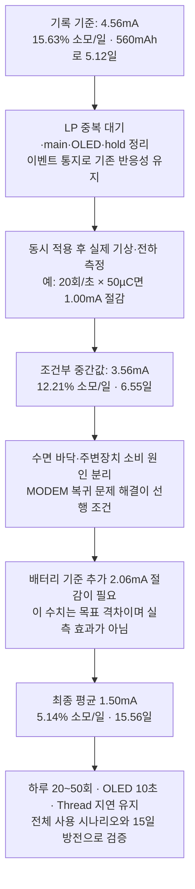

# XIAO ESP32-C6 배터리 절전 재분석

> **후속 검증:** [2026-10-16 재검증 리포트](/D:/dev/workspaces/somfy-blinds-things-by-claude/doc/POWER_SAVING_AUDIT_2026-10-16.md)를 우선 참조한다. 이후 TOP/리텐션 설정과 실험 자료가 추가되었으며, 해석기의 통계·세션 처리 한계가 확인됐다. 아래 수정별 확보 시간은 계속 조건부 계산이며 최근 변경의 실측 개선량이 아니다.

작성일: 2026-10-13, 한국 시간 기준  
대상: Seeed Studio XIAO ESP32-C6 / Matter over Thread / CC1101 약 447MHz / PCF8575 / I2C OLED / 700mAh 배터리  
사용 조건: 하루 화면 ON 20~50회, 배터리에서 OLED 10초 유지, SmartThings 명령 지연은 현재 수준 유지  
분석 범위: 현재 작업 트리의 소스·설정·SDK와 저장된 NVS 덤프의 오프라인 분석. 펌웨어 수정·빌드·플래시·시리얼 접속·새로운 실기 실험은 수행하지 않았다.

## 1. 판단과 이전 분석의 정정

**현재 자료로는 15일 사용을 달성했다고 판단할 수 없다.** CC1101 수면 핀 보정 후 장기 기록의 전류 모델 추정치는 약 4.56mA이고, 700mAh를 모두 사용할 때 약 6.4일에 해당한다. 15일을 위해서는 사용 중 소비까지 포함한 평균 전류를 이론상 1.94mA 이하, 용량 여유 20%를 고려하면 약 1.56mA 이하로 낮춰야 한다.

이번 재분석에서 이전 권고를 다음과 같이 수정한다.

| 항목 | 최신 판단 |
|---|---|
| ADC를 측정할 때만 생성·해제 | **제품용 즉시 적용 권고 철회.** MODEM 차단은 되었지만 실기 A/B에서 `ot_sleep` 락 장기 유지와 수면·Thread 이상이 관측됐다. 원인 분리 후 다시 검토해야 한다. |
| CC1101 SPWD 및 CSn 보정 | 이미 구현·커밋되어 있다. 장기 기록은 효과를 지지한다. 같은 작업을 다시 추가할 대상이 아니다. |
| HP 주변장치 전원 차단 | 아직 꺼져 있다. 다만 ADC·MODEM 복귀 문제와 드라이버·핀 보존을 먼저 다뤄야 하는 조건부 실험이다. |
| HP 태스크의 불필요한 기상 | 수정할 가치가 있다. **LP 버튼 경로에도 100ms 통지 대기 뒤 10ms 지연이 추가 실행되는 제어 흐름**을 새로 확인했다. |
| 최신 `lsfloor` 기록 | `dry=1`인 모의 실행이다. 수면 바닥 전류나 MODEM 전류를 입증하지 않는다. |
| 수면 체류율 98% | 낮은 평균 전류를 보장하지 않는다. 수면 중 도메인 유지와 진입·복귀 비용을 별도로 봐야 한다. |

권장 순서는 **안정적인 기준선 확보 → 버튼 중복 대기 제거 → 화면 OFF 태스크의 이벤트 대기 → 수면 바닥 전류 원인 분리 → 검증된 도메인 전원 관리 적용**이다. ADC 유닛 상주를 해제하거나 Thread 폴링을 늘리는 것을 첫 제품 변경으로 삼지 않는다.

## 2. 분석 기준과 자료의 신뢰 범위

분석 시점 HEAD는 `bafb638dd0003876f73e4e0a2367bef43e56d048`이다. 현재 작업 트리에는 ADC 수명 관리, 리텐션 계측, `lsfloor` 등 커밋되지 않은 변경이 있다. 따라서 **HEAD의 펌웨어, 현재 소스, 과거 덤프를 만든 펌웨어를 동일한 것으로 취급하면 안 된다.**

로컬 SDK 헤더의 버전은 ESP-IDF **5.5.5**다. [버전 헤더](/D:/dev/workspaces/esp-idf/components/esp_common/include/esp_idf_version.h)

주요 증거는 다음과 같다.

| 자료 | 용도 | 제한 |
|---|---|---|
| [COM7 CC 보정 장기 기록](/D:/dev/workspaces/somfy-blinds-things-by-claude/logs/nvs_COM7_1013_ccfix.bin) | 약 113.6시간 방전, CC 탐침·도메인 상태 | 전류는 잔량 모델의 역산값이며 시작 100% 클리핑이 있다. |
| [COM8 CC 대조군 장기 기록](/D:/dev/workspaces/somfy-blinds-things-by-claude/logs/nvs_COM8_1013_ccfix.bin) | 같은 시기의 `ccfix=0` 비교 | 다른 배터리·출발 전압이므로 정확한 절감 전류를 단정할 수 없다. |
| [COM7 ADC 실험 기록](/D:/dev/workspaces/somfy-blinds-things-by-claude/logs/nvs_COM7_1013_0653_adcab.bin) | ADC 비상주·MODEM 차단 시 실패 관측 | 현재 소스의 기본값을 과거 실행에 소급하면 안 된다. |
| [COM8 ADC 대조 기록](/D:/dev/workspaces/somfy-blinds-things-by-claude/logs/nvs_COM8_1013_0653_adcab.bin) | ADC 상주 상태의 PM 비교 | 단기 전압·잔량 변화가 장기 전류 추정과 일치하지 않는다. |
| [COM7 lsfloor 모의 기록](/D:/dev/workspaces/somfy-blinds-things-by-claude/logs/nvs_COM7_1013_0833_lsfdry.bin) | 측정 흐름·표본 저장·LP 동작 확인 | 실제 절전과 배터리 방전 실험이 아니다. |
| [기존 deep-sleep 기록](/D:/dev/workspaces/somfy-blinds-things-by-claude/logs/nvs_COM7_0929_dsleep12h.bin) | 도메인 대부분을 끈 비교 조건 | Thread 유지·LP 상태·기상 빈도가 정상 사용과 다르다. 부품별 전류 분리는 불가능하다. |

본 리포트에서 **확인**은 소스 또는 덤프에서 직접 관찰한 사실, **추정**은 모델·제어 흐름으로 도출한 값, **미확인**은 별도 실험이 필요한 내용을 뜻한다. 파일명과 수정 시각만으로 펌웨어 버전 일치를 입증하지 않는다.

## 3. 15일 목표의 전류 예산

목표 시간은 `15 × 24 = 360시간`이다.

| 계산 | 결과 |
|---|---:|
| `700mAh / 360h` | 1.944mA |
| `700mAh × 0.8 / 360h` | 1.556mA |
| CC 보정 장기 기록 추정 `700 / 4.56 / 24` | 약 6.4일 |
| 4.56mA에서 1.56mA까지 필요한 감소 | 약 66% |

80%는 설계 여유를 위한 가정이다. 셀 노화, 보호회로·보드의 종료 전압, 실제 사용 가능 용량에 따라 달라진다. 전류 예산은 **배터리 단자 기준**으로 관리해야 하며, 칩의 3.3V 전류와 그대로 더하지 않는다.

화면 ON 및 송신의 추가 부하를 포함한 평균 전류는 다음처럼 계산한다.

```text
I평균 = I대기
      + (I화면ON - I대기) × 화면ON초/일 ÷ 86400
      + RF·무선·재접속 등의 추가 전하/일 ÷ 24시간
```

하루 20~50회, 회당 10초를 각각 독립적인 표시로 가정하면 하루 200~500초다. 연속 조작으로 타임아웃이 갱신되면 실제 ON 시간은 별도로 누적해야 한다.

| 화면 ON 중 추가 전류 가정 | 하루 20회 | 하루 50회 |
|---|---:|---:|
| 30mA | 평균 +0.069mA | 평균 +0.174mA |
| 50mA | 평균 +0.116mA | 평균 +0.289mA |
| 100mA | 평균 +0.231mA | 평균 +0.579mA |

이 표는 실측값이 아니다. 추가 50mA·하루 50회를 예로 들면, 평균 1.556mA 목표 중 대기·기타 통신에 남는 예산은 약 1.267mA다. **대기 1.0~1.2mA는 합리적인 중간 설계 목표지만 15일 보장은 전체 사용 측정으로 해야 한다.**

### 3.1 한눈에 보는 소모율·확보 시간

아래에서는 **배터리 사용률을 정격 700mAh 중 하루에 소비하는 비율**로 정의한다. 시간은 정격 전량 700mAh를 쓰는 계산과, 여유 20%를 제외한 560mAh 계산을 함께 표시한다. 이전의 약 6.4일은 700mAh 기준이고 아래의 기준선 5.12일은 560mAh 기준이므로 서로 모순되지 않는다.

**4.56mA는 기존 사용 패턴을 포함한 장기 기록의 모델 평균이다. 순수 대기전류로 실측한 값은 아니다.** 이 절의 첫 두 표는 같은 사용 패턴에서 전원 유지 시간을 비교한다. 화면을 전혀 켜지 않는 순수 대기시간은 3.6절에 별도로 계산했다.


| 변경·상태 | 전류 | 하루 소모량 / 사용률 | 700mAh 전량 사용 | 560mAh 사용 | 560mAh 기준 증가 | 수치의 성격 |
|---|---:|---:|---:|---:|---:|---|
| CC 핀 보정 전 | 5.62mA | 134.88mAh / 19.27% | 5.19일 | 4.15일 | 비교 시작점 | 장기 기록의 잔량 모델 |
| **CC 핀 보정 후, 현재 비교 기준** | **4.56mA** | **109.44mAh / 15.63%** | **6.40일** | **5.12일** | **보정 전 대비 +0.97일** | 장기 기록 모델; 이미 구현됨 |
| 기상을 실제 10회/초 줄인다면¹ | 4.06mA | 97.44mAh / 13.92% | 7.18일 | 5.75일 | 기준 대비 +0.63일 | 조건부 계획 계산 |
| 기상을 실제 20회/초 줄인다면¹ | 3.56mA | 85.44mAh / 12.21% | 8.19일 | 6.55일 | 기준 대비 +1.44일 | 조건부 계획 계산 |
| 평균 2.50mA까지 낮춘다면 | 2.50mA | 60.00mAh / 8.57% | 11.67일 | 9.33일 | 기준 대비 +4.22일 | 달성 전류를 지정한 목표 계산 |
| **평균 1.50mA까지 낮춘다면** | **1.50mA** | **36.00mAh / 5.14%** | **19.44일** | **15.56일** | **기준 대비 +10.44일** | **15일을 만족하는 설계 목표** |

¹ 기상 1회당 추가 전하를 **50µC로 가정**했다. 새 실측 결과가 아니다. 한 번 덜 깨울 때 절약되는 전하가 얼마인지, 그리고 실제 기상이 몇 회 줄었는지를 먼저 확인해야 한다. CC 전·후 비교도 다른 셀의 기록이므로 +0.97일을 동일 셀에서 보장된 개선으로 해석하지 않는다. 700mAh 전량 기준의 CC 전·후 차이는 약 **+1.21일, +23%**다.

### 3.2 각 수정의 전류 절감·시간 증가: 계획용 산정

기상 관련 수정의 효과는 아래 두 값으로 정해진다.

```text
ΔI[mA] = 실제로 줄어든 기상 횟수[회/초] × 기상 1회 추가 전하[µC] / 1000
수정 후 사용 시간[일] = 사용 가능 용량[mAh] / (기준 전류 - ΔI)[mA] / 24
```

여기서 기상당 전하는 수면 진입·복귀와 해당 작업의 **대기 상태보다 추가로 소비한 전하**다. 50µC는 예를 들어 추가 50mA를 1ms 쓰는 것과 같은 크기의 가정이다. SDK의 2.52ms 전환 시간만으로 50µC를 실측했다고 판단할 수 없다.

아래 수치는 **각 항목의 절감분만 4.56mA 기준선에 환산한 크기 비교**다. 다른 태스크와 기상이 겹치지 않고 이벤트 전달이 정상 동작한다는 가정이 들어간다. 수정별 실제 전류 절감은 아직 미측정이다.


| 수정할 부분 | 대기·복귀 지점의 명목 변화 | 50µC 가정의 절감 | 기준 대비 소비 감소 | 변경 후 하루 사용률 | 560mAh 시간 환산 | 기준보다 확보하는 시간 |
|---|---|---:|---:|---:|---:|---:|
| **LP 버튼 중복 10ms 대기 제거** | 약 18.18 → 10회/초, **−8.18회/초** | 0.409mA | 9.0% | 14.23%/일 | 5.62일 | **+12.1시간** |
| **main을 이벤트 + 1초 점검으로 변경** | 유휴 10 → 1회/초, −9회/초 | 0.450mA | 9.9% | 14.09%/일 | 5.68일 | **+13.4시간** |
| OLED OFF 태스크를 통지 대기로 변경 | 유휴 2 → 주기 기상 0회/초 | 0.100mA | 2.2% | 15.29%/일 | 5.23일 | +2.8시간 |
| hold 유휴 태스크를 통지 대기로 변경 | 유휴 2 → 주기 기상 0회/초 | 0.100mA | 2.2% | 15.29%/일 | 5.23일 | +2.8시간 |
| LP 버튼 안전망을 100ms → 1초로 연장² | 10 → 1회/초의 추가분, −9회/초 | 0.450mA | 9.9% | 14.09%/일 | 5.68일 상당 | +13.4시간 상당 |

² LP 안전망 연장은 **중복 대기 제거 후** 검토하는 추가 변경이다. 마지막 행은 앞의 버튼 수정과 별개로 같은 기준선에서 절감분의 크기만 비교한 것이며, 현 코드에 단독 적용한 결과가 아니다. HP가 깨어 있는 동안의 LP 입력 전달과 짧은 탭·해제·진동·워치독을 먼저 보장해야 한다. main의 1초도 이벤트 통지와 병행하는 점검 주기 예시이며 입력·Matter 명령을 1초씩 지연시키는 설계가 아니다.

**단순 합산 금지:** +12.1시간 +13.4시간 +2.8시간 등을 더해 최종 수명으로 쓰지 않는다. 실제 기상은 서로 합쳐질 수 있고, 전원 도메인이 바뀌면 기상당 전하도 달라진다. 동시 적용 후의 전체 기상 횟수와 평균 전류를 다시 측정한다.

### 3.3 가정에 따라 숫자가 얼마나 달라지는가

기상당 추가 전하를 25~100µC로 바꾼 계산이다. **이는 신뢰구간이나 실측 상·하한이 아니다.** 이미 다른 작업 때문에 깨어 있는 경우 실제 절감은 0에 가까울 수 있고, 실제 전하는 아래 범위 밖일 수도 있다.

| 수정 항목 | 25µC 가정 | 50µC 가정 | 100µC 가정 |
|---|---:|---:|---:|
| LP 중복 대기 제거, 추가 시간 | +5.8시간 | +12.1시간 | +26.9시간 |
| main 이벤트 전환, 추가 시간 | +6.4시간 | +13.4시간 | +30.2시간 |
| OLED OFF 통지 대기, 추가 시간 | +1.4시간 | +2.8시간 | +5.6시간 |
| hold 유휴 통지 대기, 추가 시간 | +1.4시간 | +2.8시간 | +5.6시간 |
| 실제 전체 기상이 10회/초 감소한 경우, 최종 시간 | 5.41일 | 5.75일 | 6.55일 |
| 실제 전체 기상이 20회/초 감소한 경우, 최종 시간 | 5.75일 | 6.55일 | 9.11일 |

따라서 **기상 감소만으로 15일을 보장할 수 없다.** 수면 중 바닥 소비가 큰 상태라면 그 원인을 함께 줄여야 한다. 이 리포트의 우선순위는 구현 위험과 원인 확인 순서이며, 각 변경의 절감량 순위를 실측으로 확정한 것은 아니다.

### 3.4 MODEM·TOP·OLED·진단 기록의 효과를 어떻게 표시할 것인가

| 대상 | 지금 확인된 상태 | 배터리 개선량 판단 | 제품 적용 조건 |
|---|---|---|---|
| MODEM·ADC | 상주하면 MODEM ON. 비상주 실험은 수면·Thread 실패 | **현재 수정의 확보 시간은 0으로 취급.** 4.19시간에 90→37%가 관측된 실패 조건 | MODEM 복귀·ADC 간섭 원인 해결 후 재측정 |
| TOP·HP_PERIPH 전원 차단 | 현재 차단하지 않음 | **미측정.** 배터리 기준 실제 1mA를 줄이면 아래 표상 +1.44일, 2mA이면 +4.00일 | ADC·MODEM 및 SPI/RMT·핀 보존 검증 |
| OLED 모듈 VCC 차단·충전펌프 정책 | 현재는 표시 OFF 명령만 사용 | OFF 전류가 없어서 확보 시간 **산출 불가** | 모듈 전류·역급전·복귀 초기화 확인 |
| PM 프로파일링·NVS·CC 탐침 축소 | 진단 작업이 남아 있음 | 절감 전하 **미측정**. 낮은 빈도 작업을 몇 mA 절감이라고 가정하지 않음 | 필수 ULP 통지는 보존하고 전·후 비교 |
| PCF/로터리·I2C 고착·LED | 가능성만 있음 | 해당 부하가 실제 존재하는지와 배터리 전류 환산값 **미측정** | 회로·전류를 확인한 뒤 변경 |

어느 수정이든 **배터리 단자에서 다음 절감량을 확인했다면** 결과는 다음처럼 환산된다. MODEM이나 OLED가 반드시 이만큼 줄어든다는 뜻은 아니다.

| 실제 확인된 평균 전류 절감 | 수정 후 평균 전류 | 하루 배터리 사용률 | 560mAh 사용 시간 | 기준 5.12일보다 확보 |
|---:|---:|---:|---:|---:|
| 0.10mA | 4.46mA | 15.29% | 5.23일 | +0.11일, 약 2.8시간 |
| 0.30mA | 4.26mA | 14.61% | 5.48일 | +0.36일, 약 8.6시간 |
| 0.50mA | 4.06mA | 13.92% | 5.75일 | +0.63일, 약 15.1시간 |
| 1.00mA | 3.56mA | 12.21% | 6.55일 | +1.44일 |
| 2.00mA | 2.56mA | 8.78% | 9.11일 | +4.00일 |
| 3.00mA | 1.56mA | 5.35% | 14.96일 | +9.84일, 15일에 조금 못 미침 |
| **3.06mA** | **1.50mA** | **5.14%** | **15.56일** | **+10.44일** |

### 3.5 15일을 확보하기 위한 경로



이 도식은 **수정하면 자동으로 15일이 된다는 예측이 아니라, 얼마나 더 줄여야 하는지를 보여주는 목표 계산**이다. 예시의 1.00mA와 추가 2.06mA가 실제로 확보되어야 한다. 현재 자료에서 MODEM·TOP 변경의 추가 2.06mA 절감은 확인되지 않았다.

### 3.6 순수 대기시간과 하루 20~50회 사용 시간을 구분

대기전류를 별도로 측정했을 때의 계산이다. Thread 유지에 필요한 평상시 폴링은 대기전류에 포함하고, 화면을 켜는 사용은 추가 부하로 넣는다.

비교를 위해 다음을 **가정**했다.

- 표시 구간에서 OLED·CPU·그 구간의 RF를 합친 추가 부하: 50mA.
- 하루 ON 시간: 20회면 200초, 50회면 500초.
- 표시 구간 밖의 추가 통신 등에 남기는 평균 전류 예산: 0.10mA. 실측 RF 소비가 아니라 설계 여유이며 표시 구간 부하와 중복해서 세지 않는다.
- 아래 시간은 모두 560mAh를 사용할 때다. 화면 OFF 전류를 어떤 수정으로 달성할 수 있는지는 아직 미검증이다.

| 달성한 대기전류 | 화면을 켜지 않는 순수 대기시간 | 하루 20회: 전체 평균 / 시간 | 하루 50회: 전체 평균 / 시간 |
|---:|---:|---:|---:|
| 3.00mA | 7.78일 | 3.216mA / 7.26일 | 3.389mA / 6.88일 |
| 2.00mA | 11.67일 | 2.216mA / 10.53일 | 2.389mA / 9.77일 |
| 1.50mA | 15.56일 | 1.716mA / 13.60일 | 1.889mA / 12.35일 |
| 1.20mA | 19.44일 | 1.416mA / 16.48일 | 1.589mA / 14.68일 |
| **1.10mA** | **21.21일** | **1.316mA / 17.73일** | **1.489mA / 15.67일** |
| 1.00mA | 23.33일 | 1.216mA / 19.19일 | 1.389mA / 16.79일 |

**순수 대기로 15일을 버티는 것과 실제 사용하면서 15일을 버티는 것은 다르다.** 위 가정에서 하루 50회에도 15일을 확보하려면 대기전류가 약 **1.166mA 이하**여야 한다. 실용적인 목표는 대기 약 **1.1mA**, 전체 평균 약 **1.5mA**다. 실제 추가 부하나 ON 시간이 크면 목표 대기전류를 더 낮춰야 한다.

### 3.7 숫자를 확정하기 위해 필요한 측정

| 수정 | 반드시 측정할 값 | 이 리포트 숫자를 확정값으로 바꾸는 방법 |
|---|---|---|
| LP 중복 대기 제거 | 동일 세션의 기상 감소·전류·짧은 입력 성공률 | 명목 −8.18회/초 대신 실제 전체 감소와 전류 차이를 사용 |
| main/OLED/hold 이벤트 대기 | 동시 적용 후 전체 기상·응답 지연·WDT | 단독 시간 증가를 합산하지 않고 변경 후 평균 전류로 다시 계산 |
| MODEM/HP 전원 차단 | 수면 중 배터리 전류와 무선 복귀 성공률 | 정상 Thread 상태에서 확인한 ΔI만 3.4절 환산표에 적용 |
| OLED·PCF·배선·LED | 해당 부하 유무와 배터리 단자 전류 차이 | 3.3V 부품 사양을 그대로 빼지 않고 전원 변환까지 포함한 ΔI 사용 |
| 최종 15일 | 하루 ON 누적 시간·RF 사용량·전체 전하·실제 종료 시각 | 하루 20~50회 사용 시나리오로 전체 평균과 실제 방전 확인 |

그래프와 표의 산식·데이터는 [계산 JSON](/D:/dev/workspaces/somfy-blinds-things-by-claude/doc/assets/power_saving_2026-10-13/calculations.json), [항목 비교 CSV](/D:/dev/workspaces/somfy-blinds-things-by-claude/doc/assets/power_saving_2026-10-13/item_benefits.csv), [사용 시간 CSV](/D:/dev/workspaces/somfy-blinds-things-by-claude/doc/assets/power_saving_2026-10-13/life_cases.csv)에 저장했다. [그림 생성 코드](/D:/dev/workspaces/somfy-blinds-things-by-claude/doc/assets/power_saving_2026-10-13/generate_figures.py)는 ReportLab·PDFium을 사용하며 기기에 접속하지 않는다.

## 4. 최신 기록에서 확인한 결과

### 4.1 CC1101 핀 보정의 효과

| 약 113.6시간 기록 | COM7 보정 조건 | COM8 대조 조건 |
|---|---:|---:|
| 시작 전압 | 4187mV | 4112mV |
| 시작 표시 잔량 | 100% | 100% |
| 마지막 전압 | 3701mV | 3549mV |
| 마지막 전압의 모델 잔량 | 약 26.0% | 약 8.8% |
| 세션 전체 모델 평균 전류 | 약 4.56mA | 약 5.62mA |
| 탐침의 `ccp_awk` | 0 | 6915 |
| 탐침의 `ccp_slp` | 1787 | 235 |

핀 보정 조건에서 방전이 느리고 탐침 분류도 달라졌다. **CSn 보정을 유지할 근거는 충분하다.** 다만 두 셀의 상태·전압 구간이 달라, 차이 약 1.06mA를 정확한 부품 절감 전류로 확정하거나 보정 조건의 미래 수명을 보장하지 않는다.

탐침 자체의 제한도 있다. [현재 `_wake_if_pd()`](/D:/dev/workspaces/somfy-blinds-things-by-claude/main/cc1101.c:213)는 CSn을 내리는 SPI 전송에서 바로 받은 bit7을 수면 분류에 쓴다. TI는 CSn을 내린 뒤 SO가 LOW가 되기 전에 SPI 헤더를 전송하지 않도록 규정한다. 따라서 `0xFF`는 정상 응답으로 확인된 SLEEP 상태 레지스터가 아니라 **기상 초기 SO HIGH와 부합하는 간접 분류**다. 탐침과 방전 A/B는 효과를 지지하지만, 최종 확인은 CSn·SO 파형 또는 전류 측정으로 보완하는 것이 좋다. [TI CC1101 데이터시트, SPI 인터페이스](https://www.ti.com/lit/ds/symlink/cc1101.pdf)

### 4.2 ADC 수명 변경 A/B는 현재 적용하면 안 된다

PM 수치는 `pmdump/locks0 → locks`의 **배터리 구간 차분**으로 계산했다.

| 약 4.19시간 기록 | COM7 ADC 비상주 실험 | COM8 ADC 상주 대조 |
|---|---:|---:|
| 수면 체류율 | 0.2% | 98.4% |
| 수면 진입 빈도 | 약 0.08회/초 | 약 31.2회/초 |
| `ot_sleep` 보유 시간 비율 | 약 99.8% | 약 0.2% |
| 마지막 `ot_sleep` Active | 1 | 0 |
| MODEM 차단 플래그 | 기록된 요청 모두 차단 비트 있음 | 차단 비트 없음 |
| 시작 전압·표시 잔량 | 4044mV·90% | 3846mV·59% |
| 마지막 전압·표시 잔량 | 3740mV·37% | 3788mV·47% |
| 표시 잔량 감소에서 역산한 전류 | 약 89mA | 약 20mA |

COM7은 초기에는 수면했지만 뒤에는 수면이 거의 사라졌고, 후반 배터리 행에는 부모 RSSI가 없다. 현재 코드 주석의 실패 관측과 일치한다. **ADC 해제로 MODEM 차단을 가능하게 만든 사실과, Thread를 유지하면서 절전한 사실은 서로 다르다.**

로컬 [OpenThread 절전 코드](/D:/dev/workspaces/esp-idf/components/openthread/src/port/esp_openthread_sleep.c)는 IEEE 802.15.4 상태가 `RADIO_SLEEP`일 때 `ot_sleep` APB 락을 해제한다. 따라서 락 장기 보유는 무선 상태가 sleep으로 돌아오지 않았거나 그 처리 경로가 진행되지 못했다는 징후다. 덤프만으로 MODEM 복원 결함, 드라이버 동시 접근, 상태 갱신 정체 중 어느 것이 원인인지 확정하지 않는다. 락을 강제로 풀어 증상을 숨기는 수정도 권하지 않는다.

COM8은 PM 동작은 정상이지만 **단기 잔량 역산 전류 약 20mA가 장기 기준 4~6mA보다 크다.** 다른 출발 전압, 단자전압의 완화, 잔량 모델, 세션·빌드 조건을 확인해야 한다. 이 단기 대조 기록을 현재 정상 펌웨어의 확정 소비전류로 쓰지 않는다.

현재 [_bat_adc_keep_from_nvs()](/D:/dev/workspaces/somfy-blinds-things-by-claude/main/somfy_app.c)는 기본 `adcfix=0`, 즉 상주로 되돌려져 있다. COM7 실험 덤프에는 `diag/adcfix` 키가 없으므로 **현재 기본값 0을 과거 실행에 적용해 당시도 상주였다고 판정하면 안 된다.** 당시 그룹 판정은 코드의 실험 기록과 MODEM 플래그를 함께 사용했다.

### 4.3 `lsfloor`는 아직 바닥 전류 결과가 없다

최신 파일에서 확인한 값은 다음과 같다.

- `dry=1`, 단계당 40초, 표본 간격 10초, 4단계, 17개 표본.
- 해석기 판정은 `DRY`다. 실제 `esp_light_sleep_start()` 비교 결과가 아니다.
- LP 폴링 증가 31,286회, 약 195.5회/초로 LP가 모의 구간에서 계속 동작했다.
- 같은 NVS 파일의 `pmdump`는 앞선 ADC 실패 실험 값이 남아 있다. 정상 복귀 후 새로운 배터리 기준선으로 오독하면 안 된다.

무선 시작 전 MODEM ON/OFF의 실제 수면 비교는 원인 분리에 유용하다. 다만 성공해도 **Matter/Thread 유지 상태의 MODEM 복귀 검증을 대신하지 못한다.** 수면 요청 플래그는 도메인 차단 요청의 증거이며 자체가 전류계는 아니다.

## 5. 현재 소스에서 추가로 발견한 HP 기상 원인

### 5.1 LP 버튼 경로의 중복 대기 — 먼저 고칠 후보

[버튼 루프](/D:/dev/workspaces/somfy-blinds-things-by-claude/main/button_handler.c:1014)의 실제 제어 흐름은 다음과 같다. XIAO는 `BOARD_PCF_INT_ISR=0`이 기본이다.

```text
LP 경로 활성:
  입력 처리
  ulTaskNotifyTake(..., 유휴 100ms / 누름 중 10ms)
  공통 뒤쪽의 vTaskDelay(10ms)도 실행
  다음 입력 처리
```

`else`는 PCF INT 관찰 블록만 감싸고, 그 뒤의 대기 블록은 LP 분기 밖에 있다. 따라서 LP 활성 상태에서도 마지막 10ms 지연이 실행된다.

그 결과는 다음과 같다.

1. 조용한 유휴 상태의 루프 주기는 약 110ms이고, 반복 수는 약 `1000/110 = 9.09회/초`다. 최신 기록의 버튼 반복 수와 부합한다.
2. 한 반복에서 두 번 블록·복귀하므로, 마지막 10ms 지연은 다른 기상과 합쳐지지 않는 경우 추가 기상 지점을 만든다. 잠재적 추가 복귀는 약 9회/초지만 실제 수면 증가분은 스케줄 위상에 따라 다르다.
3. 마지막 `vTaskDelay()` 중 LP 통지가 와도 대기를 조기 종료하지 못한다. 통지 후 입력 처리에 최대 약 10ms의 추가 지연이 생길 수 있다.
4. 버튼 반복 카운터는 이 두 대기 중 하나만 대표한다. `전체 기상 - 태스크 반복 합`을 모두 Matter/OpenThread 몫이라고 해석하면 이 비용을 잘못 분류한다.

**권장 수정 방향:** LP 경로와 HP 직접 폴링 경로가 각자 한 번만 대기하도록 분기를 정리한다. 단순히 모든 보드의 마지막 지연을 삭제하지 않는다. HP 직접 폴링 보드에서는 기존 지연이 필요하다. LP 경로의 활동 중 10ms, 눌림 해제·디바운스·조합 전환도 함께 확인한다.

이 항목은 소스상 확정된 중복 대기다. 수정 후 절감 mA와 실기 반응성은 아직 측정하지 않았다.

### 5.2 화면 OFF에서도 반복하는 태스크

| 작업 | 현재 동작 | 권장 방향 |
|---|---|---|
| `somfy_app` | 화면 OFF에서도 루프 끝 100ms 대기 | 입력·진동·Matter·전원 변경 통지 + 다음 필요한 작업 시각까지 대기 |
| `btn_handler` LP 경로 | 100ms 통지 대기와 위의 추가 10ms 지연 | 우선 중복 제거. 이후 LP 전달 보장과 장애 점검을 전제로 안전망 주기 검토 |
| `oled_ui` | OFF에서도 500ms마다 반복 | OFF에서는 통지 대기, ON·상태 변경 때 즉시 깨움 |
| `hold_repeat` | 조작이 없어도 기본 500ms 반복 | 누름·조합 변경·송신 완료에 반응, 전환 대기 중에만 짧게 확인 |
| RF worker | 큐 대기, 60초 무작업이면 CC 탐침 | 제품 모드에서 탐침 제거 후 큐 대기. 빈도상 주된 원인은 아님 |

참조: [애플리케이션](/D:/dev/workspaces/somfy-blinds-things-by-claude/main/somfy_app.c), [OLED 태스크](/D:/dev/workspaces/somfy-blinds-things-by-claude/main/oled_ui.c:2852), [OLED 주기](/D:/dev/workspaces/somfy-blinds-things-by-claude/main/oled_ui.h:212).

주기만 늘리는 수정은 권하지 않는다. 다음 조건을 만족해야 기존 사용성을 유지할 수 있다.

- 버튼·Matter 명령이 화면 ON과 렌더 태스크를 즉시 깨운다.
- 진동 ISR/검출이 메인 루프의 100ms 확인에 의존하지 않도록 통지한다.
- HP가 이미 깨어 있는 동안의 LP 입력도 공유 래치/누산과 안전망으로 전달한다. 현재 ULP 통지는 light-sleep 복귀 콜백에 의존한다.
- main·button 태스크의 5초 Task WDT 구독을 고려한다. 무기한 대기로 바꾸면 정상 유휴도 WDT 조건에 걸릴 수 있다.
- 버튼 해제와 RF 중단, 조합 변경의 프레임 경계 처리는 유지한다. RF worker와 조합 태스크를 단순 병합하지 않는다.

### 5.3 150ms 타이머 주석은 실제 주기와 구분

현재 앱에는 `esp_sleep_enable_timer_wakeup(150000)`이 남아 있지만 자동 light-sleep은 [IDF `vApplicationSleep()`](/D:/dev/workspaces/esp-idf/components/esp_pm/pm_impl.c)에서 다음 RTOS/esp_timer 이벤트를 계산해 타이머를 다시 설정한다. 따라서 이를 별도의 지속적 150ms 폴링 타이머로 계산하면 안 된다.

유휴 태스크를 이벤트 대기로 바꾼 뒤에도 이 한 번의 설정이 버튼 안전망을 계속 제공한다고 가정하면 안 된다. 안전망은 명시적인 태스크 대기 시간과 이벤트 전달 정책으로 설계해야 한다. [Espressif 자동 절전 설명](https://docs.espressif.com/projects/esp-idf/en/v5.5.5/esp32c6/api-reference/system/power_management.html)

## 6. 수면 전원 도메인: 원인은 보이지만 해결은 미검증

현재 [XIAO 설정](/D:/dev/workspaces/somfy-blinds-things-by-claude/sdkconfig.xiao-c6)은 다음과 같다.

| 항목 | 현재 상태 |
|---|---|
| CPU 최대 주파수 | 80MHz |
| 배터리 DFS 후보 | 40~80MHz |
| Tickless idle / PM | 활성화 |
| CPU light-sleep power-down | 활성화 |
| HP peripheral light-sleep power-down | 비활성화 |
| IEEE 802.15.4 sleep | 활성화 |
| BLE | 커미셔닝 전용 |
| Thread | MTD, RX-on-idle 비활성, ICD |
| ICD slow / fast poll | 7000ms / 200ms |
| LP PCF 읽기 | 16비트, 5000µs 주기, 1회 읽기 후 halt |

ADC 상주 대조에서는 CPU·XTAL 차단 플래그가 있으나 MODEM·TOP·HP_PERIPH 차단 플래그는 없다. MODEM 유지에는 ADC 드라이버의 명시적인 ON 요청이 관여한다. HP 주변장치는 설정 자체가 차단을 허용하지 않는다. **모두 단일 ADC 원인이라고 묶지 않는다.**

`rt_init=0x60000006`, `rt_crt=0x60000004`에서 MODEM 관련 CLOCK_MODEM·BT_BB·802154_MAC 리텐션은 생성되어 있고 CLOCK_SYSTEM은 생성되지 않았다. 현재 HP 주변장치 전원 차단이 꺼진 설정과 부합한다. 리텐션 존재만으로 MODEM 복귀 후 무선 정상 동작을 입증할 수는 없다.

향후 검토할 변경은 다음과 같다.

1. MODEM OFF/ON을 무선 미시작 조건에서 비교해 바닥 전류 기여를 먼저 분리한다.
2. 무선 시작 후에는 ADC 재생성 간섭과 MODEM 차단·복원 문제를 별도 조건으로 구분한다. SDK의 PHY/MAC 상태·복귀 경로와 `ot_sleep` 상태 전이를 확인한다.
3. 위 문제가 해결되고 단독 검증이 끝난 뒤 `CONFIG_PM_POWER_DOWN_PERIPHERAL_IN_LIGHT_SLEEP`을 검토한다.
4. 그때 CC SPI의 `SPICOMMON_BUSFLAG_SLP_ALLOW_PD`, Somfy RMT의 `flags.allow_pd`, GPIO/안테나/CSn 보존을 함께 다룬다.

ADC가 상주한 채 주변장치 power-down 옵션만 켜면 로컬 ADC 드라이버는 MODEM뿐 아니라 TOP도 ON으로 요청한다. 따라서 **옵션 하나만 켜서 목표 전류에 도달한다는 보장은 없다.** LP GPIO6/7과 LP_I2C·LP RAM은 입력 감시에 필요한 자원이다. HP 절전을 위해 같이 끄지 않는다.

드라이버의 ON 요청을 임의로 강제 OFF하거나 `ot_sleep` 락을 수동 해제하는 방법 대신, 자원 소유자가 안전하게 해제하고 복원하는 경로를 사용해야 한다. [Espressif 주변장치 전원 차단·보존 요구사항](https://docs.espressif.com/projects/esp-idf/en/v5.5.5/esp32c6/api-reference/system/power_management.html)

## 7. OLED·LP 코어·PCF8575·하드웨어

### OLED

배터리 OFF 시간은 `CFG_SCREEN_OFF_SEC=10`이다. `_enter_sleep()`은 패널 OFF와 앱 상태 전환을 수행하며 CPU의 실제 절전은 PM에 맡긴다. [정책](/D:/dev/workspaces/somfy-blinds-things-by-claude/main/somfy_config.h:206)

`oled_ui_set_display_on(false)`는 `0xAE`를 보낸다. VCC 차단이 아니므로 모듈 전체 OFF 소비는 별도로 확인해야 한다. 칩의 sleep 전류 또는 코드 주석의 µA 값을 완제품 모듈의 전류로 취급하지 않는다. 우선 OFF 상태의 태스크 기상을 없애고, 모듈 OFF 전류가 크다는 증거가 있을 때 충전펌프 종료·전원 스위칭을 검토한다. 전원 스위칭은 SDA/SCL 역급전과 복귀 초기화도 포함하는 하드웨어 변경이다.

### LP 코어와 PCF8575

현재 `LP_POLL_US=5000`, `SOMFY_LP_HALT=1`이다. 예전 busy-wait 무한 실행으로 되돌릴 이유가 없다. 로터리 A/B 전이를 LP가 디코딩하므로 주기를 크게 늘리면 빠른 회전이 누락될 수 있다. [공유 설정](/D:/dev/workspaces/somfy-blinds-things-by-claude/main/lp_core/pcf_lp_config.h), [LP 프로그램](/D:/dev/workspaces/somfy-blinds-things-by-claude/main/lp_core/pcf_poll.c)

LP는 원본 16비트 `rx != last`일 때 HP wake를 요청한다. 사용하는 입력 마스크와 안정화된 버튼 이벤트·로터리 완성 디텐트 중심의 HP 통지를 검토할 수 있지만, 활동 구간의 기상을 줄이는 변경이며 조용한 대기 전류의 주된 개선으로 가정하지 않는다. 두 표본 눌림 확인과 로터리 누산은 유지해야 한다. 코드의 옛 주석 중 2ms/4ms/25ms 수치는 현재 5ms/100ms 설정과 다르므로 실제 매크로와 경로를 우선한다.

PCF8575 대기 사양은 출력 부하가 없는 조건이다. 입력 LOW로 외부에서 당기는 P-port에는 내부 전류원이 흐르고, 외부 풀업도 별도로 전류를 흘린다. EC05가 A/B=00에 멈춘 조건과 11 조건의 소비를 비교할 가치가 있다. 이는 아직 측정하지 않은 하드웨어 후보다. [TI PCF8575 전기적 특성](https://www.ti.com/lit/ds/symlink/pcf8575.pdf)

추가 확인 항목은 다음과 같다.

- SDA/SCL이 조용한 대기에서 HIGH로 유지되는지. 3.3V/4.7kΩ에서 LOW 고착 한 선은 약 0.70mA를 사용한다. 두 선이면 목표 예산에 큰 영향을 준다. 정상 HIGH인 풀업을 불필요한 상시 부하로 계산하지 않는다.
- BAT 100kΩ/100kΩ 분압의 정적 전류는 4.0V에서 약 20µA다. 제거보다 mA 단위 원인 해결을 우선한다.
- 진동 wake의 HIGH 고착을 막는 기존 보호는 유지한다. CHG_STAT의 고임피던스 레벨 wake를 재도입하지 않는다.
- 보드 USER LED, 외부 모듈 LED, 풀업 중복, 전원 IC·배터리 보호회로 소비는 회로·실측으로 확인한다.
- XIAO의 `BOARD_BATT_MAH=500`과 방전 모델의 `BAT_CAPACITY_MAH=700`이 다르다. 700mAh 셀 사용에 맞춰 용량 정의를 통일할 필요가 있으나, 이는 추정·표시 정확도를 위한 변경이며 자체가 절전은 아니다.

## 8. 진단·측정 해석에서 주의할 부분

### 수면 체류율은 수면 전류를 측정하지 않는다

PM은 `esp_light_sleep_start()` 전후 경과시간을 체류 시간에 포함한다. 전원 전환·복원 동안의 소비까지 저전류 상태였다고 가정할 수 없다. `pmdump_decode.py`의 2.52ms 고정비용과 약 8% 전환비율은 SDK 상수 기반 설명용 근사다. 실제 구간별 전류·에너지 적분 없이 평균 전류에서 그 비율만큼 빼면 안 된다.

### NVS 링은 여러 세션이 섞인다

ADC A/B 파일의 300행 링에는 과거 약 39만 초 행과 현재 0~1.5만 초 행이 같이 있다. 기존 `bat_current_estimate.py`는 링 전체 앞뒤를 잘라 전류를 계산하므로 이 파일에서 `구간 없음`을 출력한다. 이는 기록이 없다는 뜻이 아니라 **세션 경계를 분리하지 않은 분석의 한계**다.

본 분석은 `세션시작` 이후 현재 구간 행만 구분해서 시작·마지막 잔량을 확인했다. 앞으로 해석기는 세션 표식과 경과시간을 사용해 현재 세션을 먼저 분리해야 한다. 부팅 누적·평생 누적 수면 히스토그램과 기상 원인도 비교 덤프 차분 없이 현재 세션 원인으로 취급하지 않는다.

장기 CC 기록에서도 마지막 약 9시간 링 추정치는 COM7 11.19mA, COM8 1.34mA로 크게 갈린다. 출발 잔량 100% 클리핑, 잔량 곡선, 부하 단자전압, 셀 차이 때문에 **특정 전압 구간의 모델 전류로 15일 달성을 판정하면 안 된다.**

### 제품용 진단 축소

원인 분석이 끝난 뒤 PM profiling·sleep debug, 매분 PM NVS 덤프, CC 탐침, 진동 heartbeat·주기적 전압 진단 저장을 제품 모드에서 축소할 수 있다. 중요 오류와 최소 전압 기록은 남길 수 있다. 플래시 기록의 실제 전력 기여는 아직 측정하지 않았다.

**`_ls_exit_cb()`를 통째로 없애면 안 된다.** 이 안에서 ULP wake를 버튼 태스크로 전달하므로 계측과 필수 입력 통지를 분리해야 한다.

기존 `sdkconfig.defaults.xiao_c6`에는 IEEE sleep 비활성·runtime stats 활성 등 현재 `sdkconfig.xiao-c6`와 다른 값이 남아 있다. 향후 변경은 현재 설정과 재생성 기본 설정을 함께 관리하고 실제 빌드의 `config/sdkconfig.h`로 확인해야 한다.

## 9. 권장 수정·검증 순서

| 우선순위 | 작업 | 완료 판단 |
|---|---|---|
| P0 | ADC 상주·CC 핀 보정 상태의 정상 배터리 기준선 확보 | Thread·명령·수면 정상, 세션·빌드·NVS 조건 식별 가능 |
| P1 | LP 버튼 경로의 중복 10ms 대기 제거 | 짧은 탭·해제·로터리·조합 송신 정상, 같은 조건에서 기상/전류 감소 확인 |
| P1 | OLED OFF, main, hold 태스크의 이벤트 대기 | 화면·RF 반응 유지, 유휴 기상 감소, WDT 정상 |
| P1 원인 조사 | 실제 `lsfloor` ON/OFF 바닥 비교 및 MODEM 복귀 실패 분리 | dry가 아닌 플래그·전압 결과 확보, Thread 조건의 실패 원인 구분 |
| P2 조건부 | ADC/MODEM 및 HP 주변장치 전원 관리 | 수면 복귀 후 장시간 Thread·RF·OLED·ADC 정상 |
| P2 | 제품용 진단·NVS 주기 축소 | 필수 ULP 통지 유지, 실측 소비 개선 |
| P2 하드웨어 | OLED OFF 전류, PCF/로터리 LOW, I2C 고착·LED 점검 | 부품별 전류 기여가 확인된 변경만 적용 |

검증 조건은 아래와 같이 잡는 것이 좋다.

1. 먼저 동일한 보드·셀에서 동일한 출발/도착 전압과 사용 시나리오로 비교한다. 두 보드 동시 비교는 셀 차이를 분리할 교차 조건을 추가한다.
2. 펌웨어 빌드 ID, 코드 버전, `adcfix`/`ccfix`, 전원·LP·Thread 설정과 실제 실행 조건을 한 세션 메타데이터로 남긴다. 미커밋 빌드는 HEAD만으로 식별하지 않는다.
3. 입력 반응은 버튼/로터리뿐 아니라 송신 중 입력, 누름 해제, 진동, 화면 OFF 직후, Thread 수신과 겹치는 조건에서 확인한다.
4. 현재 7초 slow poll·200ms fast poll을 유지한 채 SmartThings 명령 전달 지연과 성공률을 비교한다. CSL/SSED는 과거 통신 실패 이력이 있어 검증 없이 도입하지 않는다.
5. 실기 회로에서 가능한 경우 배터리 경로에 안전한 분리·전류 측정 지점을 마련해 평균 전류와 이벤트 전하를 직접 측정한다. 현재 배터리 단자 양쪽에 전류계를 직결하는 방식은 사용하지 않는다.
6. 하루 20~50회·화면 10초의 전체 시나리오에서 평균 1.5~1.56mA 목표를 확인한다. 마지막으로 완충에서 실제 사용 종료 전압까지 15일 방전 시험을 진행한다.

일반적인 deep-sleep 전환은 Thread 명령 수신을 계속 유지하는 현재 요구를 충족하지 않는다. 별도 wake·재접속 설계 없이 제품 기본 절전으로 바꾸지 않는다. OLED 10초와 Thread 지연 요구를 완화하기 전에, 위의 불필요한 HP 기상과 수면 중 소비 원인을 먼저 해결한다.

## 10. 재현 가능한 오프라인 확인

프로젝트 루트에서 기존 덤프를 해석한 명령이다. 기기에 접속하지 않는다.

```powershell
$env:PYTHONIOENCODING = 'utf-8'
$env:PYTHONDONTWRITEBYTECODE = '1'
./.venv/Scripts/python.exe -B sim/tools/pmdump_decode.py logs/nvs_COM7_1013_0653_adcab.bin
./.venv/Scripts/python.exe -B sim/tools/pmdump_decode.py logs/nvs_COM8_1013_0653_adcab.bin
./.venv/Scripts/python.exe -B sim/tools/bat_current_estimate.py logs/nvs_COM7_1013_ccfix.bin logs/nvs_COM8_1013_ccfix.bin
./.venv/Scripts/python.exe -B sim/tools/lsfloor_decode.py logs/nvs_COM7_1013_0833_lsfdry.bin
./.venv/Scripts/python.exe -B sim/tools/batlog_decode.py logs/nvs_COM7_1013_0653_adcab.bin
```

아래 소스와 해석기를 함께 확인했다.

- [배터리·앱·PM·실험 훅](/D:/dev/workspaces/somfy-blinds-things-by-claude/main/somfy_app.c)
- [버튼 경로 및 LP 통지](/D:/dev/workspaces/somfy-blinds-things-by-claude/main/button_handler.c)
- [LP PCF 폴링](/D:/dev/workspaces/somfy-blinds-things-by-claude/main/lp_core/pcf_poll.c)
- [OLED 표시와 태스크](/D:/dev/workspaces/somfy-blinds-things-by-claude/main/oled_ui.c)
- [CC1101 SPWD 및 핀 설정](/D:/dev/workspaces/somfy-blinds-things-by-claude/main/cc1101.c)
- [XIAO 실제 설정](/D:/dev/workspaces/somfy-blinds-things-by-claude/sdkconfig.xiao-c6), [기본 설정](/D:/dev/workspaces/somfy-blinds-things-by-claude/sdkconfig.defaults.xiao_c6)
- [로컬 ADC 드라이버](/D:/dev/workspaces/esp-idf/components/esp_adc/adc_oneshot.c), [전원 차단 조건](/D:/dev/workspaces/esp-idf/components/esp_hw_support/sleep_modes.c)
- [PM 차분 해석기](/D:/dev/workspaces/somfy-blinds-things-by-claude/sim/tools/pmdump_decode.py), [방전 모델](/D:/dev/workspaces/somfy-blinds-things-by-claude/sim/tools/bat_current_estimate.py), [lsfloor 해석기](/D:/dev/workspaces/somfy-blinds-things-by-claude/sim/tools/lsfloor_decode.py)

이 리포트 작업에서는 Markdown 문서와 연결된 비교 그림·계산 자료만 작성했다. 펌웨어 코드는 수정하지 않았고 기존 미커밋 변경은 보존했다.
